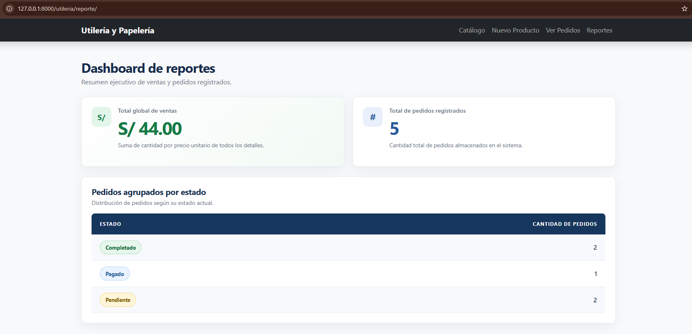

# Semana 09 — Introducción a React con Vite y JSX

Este directorio contiene el proyecto de la semana. La interfaz en React se
encuentra dentro de `frontend/`, creada con Vite; el proyecto Django de semanas
anteriores permanece en `src/`. En esta sesión solo se construye la interfaz,
con datos escritos a mano; en la Semana 12 esos datos vendrán de la API REST de
la Semana 8.

## Requisitos e instalación

Se requiere Node.js 20.19 o posterior (o 22.12 o posterior), que instala también
`npm`. Puedes verificar las versiones con:

```powershell
node -v
npm -v
```

Desde la carpeta `semana-09/frontend`, instala las dependencias declaradas en
`package.json` y ejecuta el servidor de desarrollo:

```powershell
cd frontend
npm install
npm run dev
```

La aplicación se abre en `http://localhost:5173/` (en Django era el puerto
8000). `Ctrl + C` detiene el servidor. Cada vez que se guarda un archivo, el
navegador se actualiza solo (recarga en caliente).

El proyecto se creó con:

```powershell
npm create vite@latest frontend -- --template react
```

## Herramientas utilizadas

| Herramienta | Para qué sirve | Equivalente en Python/Django |
|---|---|---|
| **Node.js** | Ejecuta JavaScript fuera del navegador; permite usar Vite y npm. | Python |
| **npm** | Descarga, instala y administra librerías de JavaScript. | pip |
| **package.json** | Declara las dependencias y los scripts del proyecto. | `requirements.txt` |
| **node_modules/** | Carpeta con las librerías instaladas por `npm install`. | Entorno virtual (`venv`) |
| **Vite** | Crea el proyecto, levanta el servidor local y compila para producción. | `python manage.py runserver` |
| **React** | Librería para construir interfaces con componentes (SPA). | Templates de Django |

Una **SPA** (Single-Page Application) carga un solo HTML y un JavaScript una
vez; al cambiar de pantalla solo se actualiza la parte que cambió, y es el
navegador (React) quien arma el HTML. En Django con Templates, el servidor
envía una página HTML nueva en cada petición.

## Scripts de `package.json`

| Comando | Para qué sirve |
|---|---|
| `npm run dev` | Servidor de desarrollo con recarga en caliente |
| `npm run build` | Genera la carpeta `dist/` optimizada para producción |
| `npm run preview` | Prueba localmente el resultado del build |
| `npm run lint` | Revisa el código con `oxlint` |

Versiones declaradas: React 19 y Vite 8. Las carpetas `dist/` y `node_modules/`
están en `.gitignore` y no se suben a GitHub.

## Estructura del proyecto

```
frontend/
├── index.html        ← la única página HTML
├── package.json      ← dependencias y scripts
├── vite.config.js    ← configuración de Vite (plugin de React)
├── public/           ← archivos estáticos (favicon, íconos)
└── src/
    ├── main.jsx      ← punto de entrada de React
    ├── App.jsx       ← componente principal
    ├── App.css       ← estilos de App
    ├── index.css     ← estilos globales
    └── assets/       ← imágenes
```

### Del HTML a la pantalla

1. **`index.html`** contiene el `<div id="root"></div>` y carga
   `/src/main.jsx` como módulo.
2. **`src/main.jsx`** monta React con
   `createRoot(document.getElementById('root')).render(<App />)`, es decir,
   dibuja el componente `App` dentro del div `root`. `StrictMode` ayuda a
   detectar problemas durante el desarrollo.
3. **`src/App.jsx`** describe la interfaz con JSX y contiene los datos.
4. El navegador muestra el HTML generado por React.

En Django el flujo es URL → View → Template → respuesta HTML en cada petición;
en React se carga `index.html` una vez y `App.jsx` dibuja las pantallas.

## JSX en `App.jsx`

JSX es una sintaxis parecida a HTML dentro de JavaScript que se transforma en
JavaScript al compilar. Reglas aplicadas: una sola raíz (`<div className="container">`),
todas las etiquetas cerradas, `className` en lugar de `class` y llaves `{ }`
para insertar JavaScript.

El componente `App`, en `frontend/src/App.jsx`, tiene dos partes:

- **Parte guiada:** «Sistema de Gestión Empresarial - Utilería», con
  `productos` y `pedidos`.
- **Investigación propia:** «Sistema de Gestión de Inventario», con
  `productosIndependientes` y `categorias`.

### Expresiones con `{ }`

Se muestran variables y resultados de funciones, por ejemplo el nombre de la
aplicación y el precio con IGV del 18 %:

- `calcularPrecioConIGV(precioBase, porcentajeIGV)` devuelve
  `precio × (1 + igv)` con dos decimales.
- `calcularMontoIGV(presupuestoBase, igvAplicado)` calcula el monto del IGV
  sobre el presupuesto del área.

Dentro de las llaves solo se escriben expresiones; en lugar de `if` y `for` se
usan el ternario, `&&` y `map()`.

### Listas con `map()` y `key`

`productos.map((prod) => <li key={prod.id}>...</li>)` recorre el arreglo y
genera un elemento por registro. El `key` usa el `id`, igual que la clave
primaria en la base de datos, y permite a React identificar cada elemento.

Los datos tienen la misma forma que la respuesta de `GET /api/productos/` de la
Semana 8. Como el precio llega como texto, se usa
`Number(prod.precio).toFixed(2)` para mostrarlo con dos decimales.

### Renderizado condicional

- **Ternario:** `prod.stock === 0 ? "Agotado" : "Stock: N"` muestra una
  etiqueta u otra según el stock.
- **Operador `&&`:** `prod.stock > 0 && prod.stock <= 3 && ...` muestra
  «¡Últimas unidades!» solo cuando quedan pocas unidades (hasta 4 en el
  catálogo de investigación).
- **Lista vacía:** `productos.length === 0 ? <p>No hay registros...</p> : <ul>...</ul>`
  cumple la función de `` en Django.

### Relaciones 1:N con listas anidadas

Un `map()` dentro de otro muestra la relación 1:N:

1. **Pedido → Detalles:** cada pedido muestra su cliente, fecha y estado, y
   luego sus detalles (`producto_nombre`, `cantidad`, `precio_unitario`). El
   total se calcula con `reduce()` sumando `cantidad × precio_unitario`.
2. **Categoría → Productos:** cada categoría muestra la cantidad de productos
   que tiene (`cat.productos.length`, con «producto» o «productos» según el
   número) y el valor total del stock, calculado con `reduce()` como
   `stock × precio`.

### Atributos y estilos

| HTML | JSX |
|---|---|
| `class` | `className` |
| `for` | `htmlFor` |
| `style="color: red"` | `style={{ color: "red" }}` |
| `{# comentario #}` (Django) | `{/* comentario */}` |

Los estilos de las clases (`card-pedido`, `badge`, `lista-productos`, etc.)
están en `App.css`, y los estilos en línea con `style={{ }}` se usan para los
títulos y los totales calculados.

## Equivalencias con Django Templates

| Django Template | React (JSX) |
|---|---|
| `{{ variable }}` | `{variable}` |
| `` | `{productos.map((p) => ...)}` |
| `` | `{stock === 0 && ...}` o un ternario |
| `` | `{productos.length === 0 && ...}` |
| `{{ precio\|floatformat:2 }}` | `{Number(precio).toFixed(2)}` |

## Errores comunes

| Error | Mensaje | Solución |
|---|---|---|
| `class` en lugar de `className` | Invalid DOM property `class` | Escribir `className` |
| Falta `key` en la lista | Each child in a list should have a unique "key" prop | Agregar `key={p.id}` |
| Mostrar un objeto completo | Objects are not valid as a React child | Mostrar un campo: `{producto.nombre}` |
| Varios elementos sin raíz | Adjacent JSX elements must be wrapped in an enclosing tag | Envolver en `<div>` o `<>...</>` |
| Etiqueta sin cerrar | Expected corresponding JSX closing tag for 'img' | Cerrar con `` |

## Evidencia

<!-- Reemplazar image-1.png por la captura de http://localhost:5173/ -->


## Publicar en GitHub

```powershell
git status
git add README.md frontend
git commit -m "Documentar laboratorio Semana 09: React, Vite y JSX"
git push
```
