# Semana 10 — Componentes en React

**Repositorio de GitHub:** <https://github.com/Davish-pxl/APLICACIONES-EMPRESARIALES-CICLO-IV->

**Carpeta de esta semana:** <https://github.com/Davish-pxl/APLICACIONES-EMPRESARIALES-CICLO-IV-/tree/main/semana-10>

Este laboratorio convierte el `App.jsx` de la Semana 9, que tenía todo en un
solo archivo, en **componentes funcionales reutilizables** que reciben datos
por **props**, guardan **estado** con `useState`, responden a **eventos** y
validan **formularios controlados**. Se trabajó con dos entidades:

- **Parte guiada:** Productos y Pedidos (relación 1:N con sus detalles).
- **Investigación propia:** Categorías (relación 1:N con sus productos), la misma
  entidad del recurso `/api/categorias/` de la Semana 8.

## Cómo ejecutar el frontend

Requisitos: **Node.js** 20.19+ o 22.12+ (requisito de Vite 8; probado con Node 24) y **npm**.

```powershell
cd semana-10/frontend
npm install        # descarga las dependencias en node_modules/ (no se versiona)
npm run dev        # servidor de desarrollo de Vite
```

Abrir la dirección que muestra la terminal (por defecto
`http://localhost:5173/`; si ese puerto está ocupado, Vite usa el siguiente,
por ejemplo `5174`).

Otros comandos:

| Comando | Qué hace |
|---|---|
| `npm run lint` | Revisa el código con `oxlint`. Resultado actual: 0 advertencias y 0 errores |
| `npm run build` | Genera la versión de producción en `dist/` (no se versiona) |
| `npm run preview` | Sirve localmente la carpeta `dist/` generada por el build |

Los datos de ejemplo están en `frontend/src/datos.js`. Los registros agregados
desde los formularios viven en el estado de React y se pierden al recargar la
página (ver Ejercicio 8, sección 6).

## Componentes creados

Todos están en `frontend/src/components/`, un componente por archivo, con
nombre en PascalCase y `export default`.

### Parte guiada (Productos y Pedidos)

| Componente | Qué hace | Props | Estado |
|---|---|---|---|
| `TarjetaProducto` | Muestra **un producto**: nombre, código, precio, badges de stock ("Agotado" / "Stock: n" / "¡Últimas unidades!") y un botón **"+ Agregar"** con contador. El botón se desactiva sin stock o al llegar al máximo | `nombre`, `codigo`, `precio`, `stock = 0`, `limiteUltimas = 3` | `cantidad` (contador) |
| `ListaProductos` | Recibe un **arreglo de productos** y crea una `TarjetaProducto` por cada uno con `map()` y `key`. Incluye un **buscador** controlado por nombre (sin distinguir mayúsculas) y mensajes de lista vacía o sin coincidencias | `productos`, `limiteUltimas`, `mensajeVacio = '…'` | `busqueda` |
| `Tarjeta` | **Contenedor genérico**: dibuja el marco con estilo de tarjeta y un título, y coloca dentro lo que reciba como `children` | `titulo`, `children` | — |
| `DetallePedido` | **Relación 1:N** Pedido → Detalles: cabecera del pedido, un `ItemDetalle` por cada detalle y el **total calculado** con `reduce()`. Convierte los nombres de la API (`producto_nombre`, `precio_unitario`) a props en camelCase | `pedido` | — |
| `ItemDetalle` | Una línea de detalle de pedido con su **subtotal** | `nombreProducto`, `cantidad`, `precioUnitario` | — |
| `FormularioProducto` | **Formulario controlado** (código, nombre, precio, stock) con `onSubmit` + `preventDefault`. Valida la regla `precio > 0` de `ProductoSerializer` (Semana 8), muestra los errores, llama a `onAgregar` y limpia los campos | `onAgregar` | `datos`, `errores`, `mensajeExito` |

### Investigación propia (Categorías)

| Componente | Qué hace | Props | Estado |
|---|---|---|---|
| `ListaCategorias` | Recibe el **arreglo de categorías** y crea una `TarjetaCategoria` por cada una con `map()` y `key={cat.id}`. Incluye un **buscador** por nombre o descripción, los mismos campos que `search_fields` del `CategoriaViewSet` | `categorias`, `mensajeVacio = '…'` | `busqueda` |
| `TarjetaCategoria` | Muestra **una categoría** dentro de una `Tarjeta`, con un botón **"Ver productos (n)" / "Ocultar productos"** que muestra u oculta su relación 1:N. El botón se desactiva si la categoría no tiene productos | `id`, `nombre`, `descripcion = 'Sin descripción'`, `productos = []` | `abierta` |
| `DetalleCategoria` | **Relación 1:N** Categoría → Productos: conteo, un `ItemProductoCategoria` por producto y el **valor total del stock** con `reduce()` | `productos = []` | — |
| `ItemProductoCategoria` | Un producto dentro de una categoría, con sus badges de stock | `nombreProducto`, `codigo`, `precio`, `stock = 0`, `limiteUltimas = 3` | — |
| `FormularioCategoria` | **Formulario controlado** (nombre y descripción) con `onSubmit` + `preventDefault`. Valida la regla de `CategoriaSerializer.validate_nombre` (Semana 8): *mínimo 3 caracteres*. Guarda la descripción vacía como `null` | `onAgregar` | `datos`, `errores`, `mensajeExito` |

### `App.jsx` y la estructura de componentes

`App` guarda las dos listas que pueden crecer
(`listaProductos` y `listaCategorias`, con `useState`) y les pasa a los
formularios las funciones `agregarProducto` y `agregarCategoria`. Esas
funciones crean **arreglos nuevos** con `[...lista, nuevo]`, sin `push`.

```
App  (estado: listaProductos, listaCategorias)
├── TarjetaProducto ×2                         (demostración de props y valor por defecto)
├── Tarjeta → FormularioProducto               (onAgregar = agregarProducto)
├── ListaProductos → TarjetaProducto           (listado guiado, con buscador)
├── DetallePedido → Tarjeta → ItemDetalle      (pedidos 1:N)
├── ListaProductos → TarjetaProducto           (Entidad 1, limiteUltimas = 4)
├── Tarjeta → FormularioCategoria              (onAgregar = agregarCategoria)
└── ListaCategorias → TarjetaCategoria → Tarjeta → DetalleCategoria → ItemProductoCategoria
```

## ¿Qué resuelven las props y el estado?

Las **props** resuelven el problema de **repetir código**. En la Semana 9 el
mismo JSX de la tarjeta de un producto estaba copiado tres veces en `App.jsx`,
y la regla de "¡Últimas unidades!" ya había quedado distinta en cada copia.
Con props, el JSX se escribe **una sola vez** en un componente, y cada uso le
pasa sus propios datos, como los argumentos de una función. Los datos bajan del
padre al hijo y el hijo solo los **lee**: no puede modificarlos (en el
Ejercicio 5, intentarlo produjo un `TypeError`). Así siempre se sabe quién es
el dueño de cada dato.

El **estado** resuelve el problema de los datos que **cambian mientras el
usuario usa la página**: el contador de un botón, el texto de un buscador, si
una categoría está abierta, lo que se escribe en un formulario o la lista que
crece al agregar un registro. Una variable normal (`let`) no sirve, porque
React no se entera de que cambió y además se reinicia en cada render, como se
comprobó en el Ejercicio 6. `useState` **recuerda** el valor entre renders y,
al llamar a su función `set…`, **avisa** a React para que vuelva a dibujar solo
lo necesario. Cada componente tiene su propio estado, así que dos tarjetas del
mismo producto llevan contadores independientes.

Juntos forman el flujo de datos de React: el estado vive en el componente que
es dueño del dato (por ejemplo, la lista en `App`) y baja como props a los
componentes que lo muestran. Cuando un hijo necesita cambiarlo (el
formulario), recibe una función por props y la llama.

**Lo que falta para guardar en Django** (detalle en el Ejercicio 8,
sección 6): hoy los registros nuevos solo existen en la memoria del navegador.
Para guardarlos en la base de datos de la Semana 8 hay que:

- enviarlos con `fetch` (`POST /api/productos/` o `/api/categorias/`);
- habilitar **CORS** en Django con `django-cors-headers`;
- usar el `id` real que devuelve la respuesta `201`;
- mostrar en el formulario los errores del serializer que llegan con un `400`;
- cargar las listas iniciales con un `GET` dentro de `useEffect`.

## Índice de ejercicios

| # | Ejercicio | Evidencias principales |
|---|---|---|
| 1 | Recuperar el proyecto e identificar los componentes | `ej1-*.png` |
| 2 | Primer componente funcional | `ej2-componente-dos-veces.png`, `ej2-minuscula-no-renderiza.png` |
| 3 | Props y lista con `map()` y `key` | `ej3-props-y-lista.png`, `ej3-lista-reutilizada-entidad1.png` |
| 4 | Contenedor con `children` | `ej4-tarjeta-pedidos.png`, `ej4-tarjeta-categorias.png` |
| 5 | Relación 1:N y props de solo lectura | `ej5-detalle-pedido.png`, `ej5-modificar-props-pagina-en-blanco.png` |
| 6 | Estado y evento de clic | `ej6-contadores-independientes.png`, `ej6-let-no-actualiza.png` |
| 7 | Campo controlado que filtra | `ej7-busqueda-1-cuaderno.png`, `ej7-busqueda-2-ar.png`, `ej7-sin-resultados.png` |
| 8 | Formulario con `onSubmit` y validación, lint y build | `ej8-validacion-error.png`, `ej8-envio-correcto.png`, `ej8-npm-run-*.txt` |
| 9 | Tabla de equivalencias de la investigación propia | — |
| 10 | Componentes y props de la investigación propia | `ej10-componentes-categorias.png` |
| 11 | Estado, eventos y buscador (antes y después) | `ej11-*.png` |
| 12 | Relación anidada y formulario (envío válido e inválido) | `ej12-*.png` |
| 13 | Verificación: consola, lint, build y `.gitignore` | `ej13-*.png`, `ej13-*.txt` |
| 14 | Publicar en GitHub | este README |

Todas las capturas están en la carpeta [`capturas/`](capturas/).

---

## Ejercicio 1 — Recuperar el proyecto e identificar los componentes

### 1. Recuperar el proyecto

El proyecto de React de la Semana 9 se copió a `semana-10/frontend`. Para ejecutarlo:

```powershell
cd frontend
npm install
npm run dev
```

Vite levanta la aplicación en `http://localhost:5173/`. Tras mover los datos a
`src/datos.js`, la aplicación se renderiza igual que en la Semana 9 y la consola
del navegador no muestra errores.

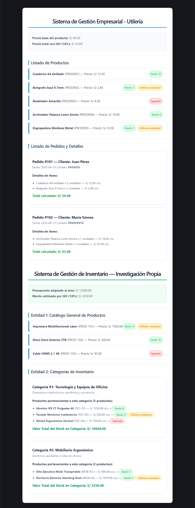

### 2. Tres candidatos a componente en `App.jsx`

En `App.jsx` cada candidato quedó marcado con un comentario `CANDIDATO N`.

#### Candidato 1 — `TarjetaProducto` (la tarjeta de un registro)

El fragmento es el `<li className="item-producto">` que muestra el nombre, el
código, el precio y los badges de stock de **un** producto.

**Justificación**
- **Se repite.** El mismo JSX aparece tres veces: en el listado guiado, en la
  Entidad 1 y, casi igual, en los productos de cada categoría. Hoy un cambio de
  diseño obliga a editar los tres lugares.
- **Concentra la lógica condicional.** La regla de stock (ternario
  Agotado/Stock y `&&` para "¡Últimas unidades!") quedaría en un solo lugar. Hoy
  la regla ya diverge: el umbral es `<= 3` en un listado y `<= 4` en otro. Como
  componente, el umbral puede pasarse como prop.
- **Depende de un solo dato.** Solo necesita un objeto `producto`, así que su
  interfaz sería simple: `<TarjetaProducto producto={prod} />`.

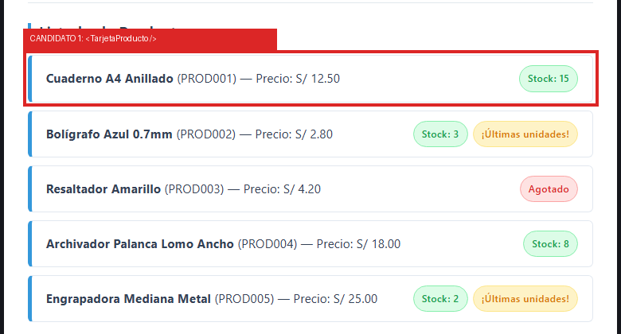

#### Candidato 2 — `ListaProductos` (la lista de registros)

El fragmento es el bloque que comprueba `productos.length === 0` y muestra el
mensaje de lista vacía o el `<ul className="lista-productos">` con el `map()`.

**Justificación**
- **Se repite.** El bloque lista vacía + `<ul>` + `map()` con `key` aparece de
  forma idéntica para `productos` y para `productosIndependientes`. Solo cambian
  el arreglo y el texto del mensaje vacío.
- **Tiene una responsabilidad propia.** Su tarea es recorrer una colección y
  manejar el caso vacío. Cómo se dibuja cada elemento le corresponde a
  `TarjetaProducto`, de modo que componer los dos componentes separa
  responsabilidades.
- **Se parametriza con props.** Su uso sería
  `<ListaProductos productos={...} mensajeVacio="..." />`.

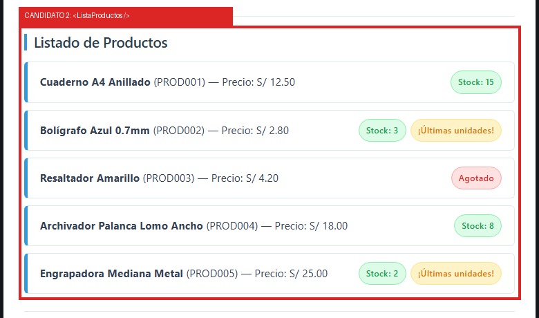

#### Candidato 3 — `DetallePedido` (el detalle de una relación 1:N)

El fragmento es la tarjeta `card-pedido` de un pedido, con su cabecera
(cliente, fecha y estado), la lista anidada de detalles y el total calculado
con `reduce()`.

**Justificación**
- **Representa la relación 1:N.** Un pedido tiene muchos detalles. Encapsular
  la tarjeta aísla el recorrido anidado (`pedido.detalles.map`) y el cálculo del
  total, que hoy viven dentro del `map` externo de `App`.
- **Tiene un cálculo propio.** `totalPedido` solo depende de un pedido, así que
  debería calcularse dentro de su componente y no ensuciar a `App`.
- **El patrón se repite.** La tarjeta de categoría (Entidad 2) usa la misma
  estructura (cabecera, lista hija, conteo o total), por lo que puede seguir el
  mismo diseño, por ejemplo con un componente `DetalleCategoria`.
- Su uso sería `<DetallePedido pedido={pedido} />`.

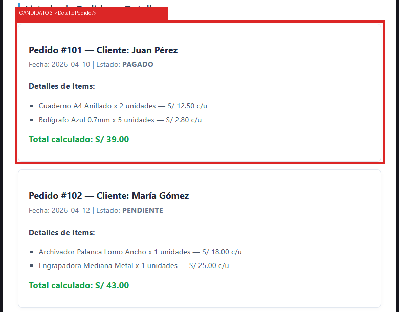

### 3. Estructura de carpetas

Se creó la carpeta `src/components` para alojar los componentes de los
siguientes ejercicios. Los arreglos escritos a mano (`productos`, `pedidos`,
`productosIndependientes` y `categorias`) se movieron de `App.jsx` a
`src/datos.js`, que los exporta. `App.jsx` ahora los importa:

```js
import { productos, pedidos, productosIndependientes, categorias } from './datos'
```

```
semana-10/
├── .gitignore         ← Ejercicio 13
├── README.md
├── capturas/
│   ├── ej1-app-npm-run-dev.png
│   ├── ej1-candidato1-tarjeta-producto.png
│   ├── ej1-candidato2-lista-productos.png
│   └── ej1-candidato3-detalle-pedido.png
└── frontend/
    ├── index.html
    ├── package.json
    ├── vite.config.js
    ├── public/
    └── src/
        ├── assets/
        ├── components/      ← nueva
        │   ├── TarjetaProducto.jsx   ← Ejercicio 2 (props: Ej. 3, estado: Ej. 6)
        │   ├── ListaProductos.jsx    ← Ejercicio 3 (búsqueda: Ej. 7)
        │   ├── Tarjeta.jsx           ← Ejercicio 4
        │   ├── DetallePedido.jsx     ← Ejercicio 5 (1:N)
        │   ├── FormularioProducto.jsx ← Ejercicio 8
        │   ├── ListaCategorias.jsx   ← Ejercicio 10 (buscador: Ej. 11)
        │   ├── TarjetaCategoria.jsx  ← Ejercicio 10 (estado: Ej. 11)
        │   ├── DetalleCategoria.jsx  ← Ejercicio 10 (investigación)
        │   ├── ItemProductoCategoria.jsx ← Ejercicio 10 (investigación)
        │   ├── FormularioCategoria.jsx ← Ejercicio 12 (investigación)
        │   └── ItemDetalle.jsx       ← Ejercicio 5 (elemento anidado)
        ├── App.css
        ├── App.jsx          ← importa los datos y marca los 3 candidatos
        ├── datos.js         ← nuevo: datos escritos a mano
        ├── index.css
        └── main.jsx
```

## Ejercicio 2 — Crear el primer componente funcional

### El componente

Se creó [`frontend/src/components/TarjetaProducto.jsx`](frontend/src/components/TarjetaProducto.jsx).
Es un componente funcional: una función de JavaScript cuyo nombre empieza con
mayúscula y que devuelve el JSX de **un** registro de la entidad principal
(Producto): nombre, código, precio y badges de stock. Se exporta con
`export default`:

```jsx
function TarjetaProducto() {
  const producto = { id: 1, codigo: "PROD001", nombre: "Cuaderno A4 Anillado", precio: "12.50", stock: 15 };

  return (
    <div className="item-producto">
      <div className="info-producto">
        <strong>{producto.nombre}</strong> ({producto.codigo}) —
        <span> Precio: S/ {Number(producto.precio).toFixed(2)}</span>
      </div>
      {/* ...badges de stock con ternario y && ... */}
    </div>
  );
}

export default TarjetaProducto;
```

Por ahora el registro está escrito dentro del componente. En el siguiente paso
se recibirá mediante *props* para que cada tarjeta muestre un producto distinto.

### Importarlo y usarlo dos veces en `App.jsx`

Como es un `export default`, se importa sin llaves y con el nombre que se elija:

```jsx
import TarjetaProducto from './components/TarjetaProducto'

// ...dentro del return de App
<h2 className="subtitulo-seccion">Ejercicio 2: Componente TarjetaProducto (x2)</h2>
<div className="lista-productos">
  <TarjetaProducto />
  <TarjetaProducto />
</div>
```

Cada `<TarjetaProducto />` es una instancia independiente de la misma
función. El JSX se escribe una sola vez y se reutiliza.

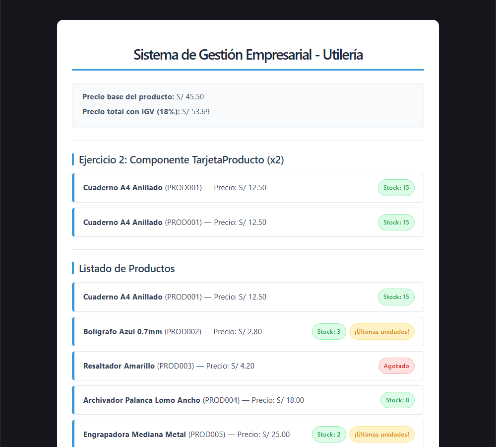

### ¿Qué ocurre si el nombre del componente se escribe en minúscula?

JSX usa la primera letra para decidir qué es cada etiqueta:

- **Mayúscula** (`<TarjetaProducto />`): JSX la trata como una **variable de
  JavaScript** y la compila a `React.createElement(TarjetaProducto)`. React
  ejecuta la función y dibuja el JSX que devuelve.
- **Minúscula** (`<tarjetaProducto />`): JSX la trata como una **etiqueta HTML
  nativa**, igual que `<div>` o `<span>`, y la compila a
  `React.createElement("tarjetaProducto")`, es decir, con el nombre **como
  texto**. React nunca llama a la función. Intenta crear en el DOM un elemento
  llamado `<tarjetaproducto>`, que el navegador no conoce y deja vacío.

Lo comprobé cambiando el nombre a minúscula de forma temporal (luego lo
revertí):

1. **No se produce un error que detenga la aplicación.** El resto de la página
   carga normalmente, pero la sección del Ejercicio 2 queda **vacía**. En el DOM
   aparecen dos etiquetas `<tarjetaproducto></tarjetaproducto>` sin contenido.
2. **React muestra advertencias en la consola del navegador:**
   - `<tarjetaProducto /> is using incorrect casing. Use PascalCase for React components, or lowercase for HTML elements.`
   - `The tag <tarjetaProducto> is unrecognized in this browser. If you meant to render a React component, start its name with an uppercase letter.`
3. **El linter (`oxlint`) avisa** que el import `tarjetaProducto` "is imported
   but never used". Esto confirma que la etiqueta en minúscula no usa la
   variable importada, sino solo un texto.

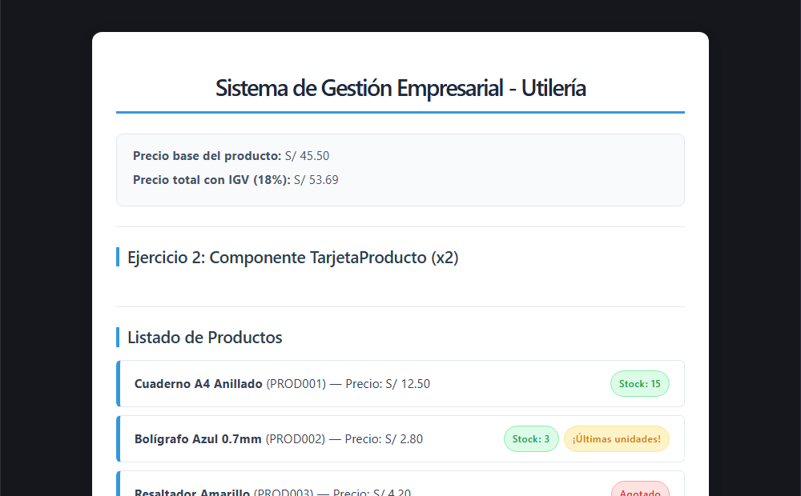

**Conclusión:** el nombre de un componente debe empezar con mayúscula
(PascalCase). Así JSX lo distingue de las etiquetas HTML y React sabe que debe
ejecutar la función. Por convención, el archivo lleva el mismo nombre que el
componente (`TarjetaProducto.jsx`).

## Ejercicio 3 — Pasar datos con props y armar la lista

### 1. `TarjetaProducto` recibe el registro por props

En el Ejercicio 2 el producto estaba escrito dentro del componente, así que las
dos tarjetas eran iguales. Ahora el componente recibe los datos como
**props**, desestructuradas directamente en los parámetros de la función:

```jsx
// frontend/src/components/TarjetaProducto.jsx
function TarjetaProducto({ nombre, codigo, precio, stock = 0, limiteUltimas = 3 }) {
  return (
    <li className="item-producto">
      <div className="info-producto">
        <strong>{nombre}</strong> ({codigo}) —
        <span> Precio: S/ {Number(precio).toFixed(2)}</span>
      </div>

      <div className="badges-container">
        {stock === 0 ? (
          <span className="badge agotado">Agotado</span>
        ) : (
          <span className="badge disponible">Stock: {stock}</span>
        )}

        {stock > 0 && stock <= limiteUltimas && (
          <span className="badge ultima-unidades">¡Últimas unidades!</span>
        )}
      </div>
    </li>
  );
}

export default TarjetaProducto;
```

- **Desestructuración.** En vez de recibir un objeto `props` y escribir
  `props.nombre`, `props.precio`, etc., se extraen las propiedades en la propia
  firma: `({ nombre, codigo, precio, stock })`. El JSX queda más limpio y la
  firma muestra de un vistazo qué datos necesita el componente.
- **Valores por defecto:**
  - **`stock = 0`**: si quien usa el componente no envía `stock`, se asume 0 y
    la tarjeta muestra **Agotado**, en lugar de mostrar `Stock: undefined`.
  - **`limiteUltimas = 3`**: desde cuántas unidades aparece "¡Últimas
    unidades!". En la Semana 9 este umbral estaba copiado como `<= 3` en un
    listado y `<= 4` en otro. Ahora es una sola regla configurable.
- La tarjeta devuelve un `<li>` porque siempre se usa dentro de un `<ul>`.

Uso directo con props. A la segunda tarjeta **no se le pasa `stock`**, así que
toma el valor por defecto:

```jsx
<ul className="lista-productos">
  <TarjetaProducto nombre="Cuaderno A4 Anillado" codigo="PROD001" precio="12.50" stock={15} />
  {/* Sin la prop stock → se usa el valor por defecto (stock = 0) */}
  <TarjetaProducto nombre="Corrector Líquido" codigo="PROD006" precio="3.50" />
</ul>
```

Las props de texto se pasan entre comillas (`nombre="..."`). Las de número o
cualquier otra expresión de JavaScript se pasan entre llaves (`stock={15}`).

### 2. Segundo componente: `ListaProductos`

Recibe el **arreglo** de registros y, con `map()`, crea una `TarjetaProducto`
por cada uno. Usa el `id` como `key`:

```jsx
// frontend/src/components/ListaProductos.jsx
import TarjetaProducto from './TarjetaProducto';

function ListaProductos({ productos, limiteUltimas, mensajeVacio = "No hay registros de productos disponibles." }) {
  if (productos.length === 0) {
    return <p className="alerta-vacio">{mensajeVacio}</p>;
  }

  return (
    <ul className="lista-productos">
      {productos.map((prod) => (
        <TarjetaProducto
          key={prod.id}
          nombre={prod.nombre}
          codigo={prod.codigo}
          precio={prod.precio}
          stock={prod.stock}
          limiteUltimas={limiteUltimas}
        />
      ))}
    </ul>
  );
}

export default ListaProductos;
```

- **`map()`** transforma cada objeto del arreglo en un elemento
  `<TarjetaProducto />`. React dibuja el arreglo de elementos resultante.
- **`key={prod.id}`**: la `key` identifica cada elemento de la lista para que
  React sepa cuál cambió, cuál se agregó o cuál se eliminó al volver a
  renderizar, sin redibujar todo. Se usa el `id` porque es único y estable. El
  índice del `map` cambiaría si se reordena o se filtra la lista. La `key` se
  pone en el elemento que devuelve el `map()`, es decir, en `<TarjetaProducto>`
  y no en el `<li>` interno. No llega al componente como prop: React la usa solo
  internamente.
- **Lista vacía.** El caso `productos.length === 0` que antes estaba en `App`
  ahora vive dentro del componente. El mensaje es una prop con valor por
  defecto.
- **`limiteUltimas`** se reenvía a cada tarjeta. Si no se envía, llega como
  `undefined` y `TarjetaProducto` aplica su valor por defecto (3).

### 3. Uso en `App.jsx`

Los dos bloques de lista que antes estaban duplicados (cerca de 30 líneas cada
uno) ahora son una sola línea cada uno:

```jsx
import ListaProductos from './components/ListaProductos'

// Parte guiada
<h2 className="subtitulo-seccion">Listado de Productos</h2>
<ListaProductos productos={productos} />

// Investigación propia — mismo componente, otro arreglo, otro límite y otro mensaje
<ListaProductos
  productos={productosIndependientes}
  limiteUltimas={4}
  mensajeVacio="No hay registros de productos independientes en el sistema."
/>
```

### 4. Resultado en el navegador

- En **Componente TarjetaProducto**, cada tarjeta muestra ahora sus propios
  datos. El *Corrector Líquido*, al que no se le pasó `stock`, aparece como
  **Agotado** por el valor por defecto.
- En **Listado de Productos**, `ListaProductos` dibuja las 5 tarjetas del
  arreglo `productos` con los mismos badges que en la Semana 9.

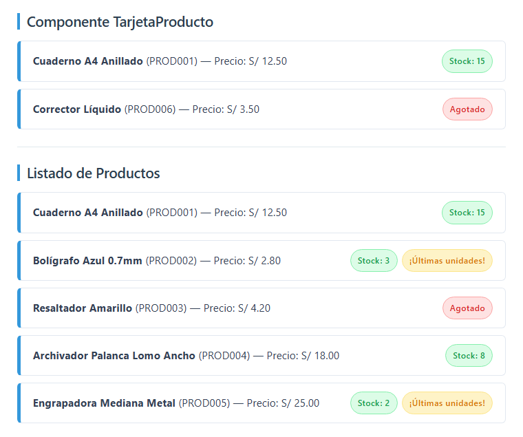

- En la **Entidad 1**, el mismo `ListaProductos` se reutiliza con
  `productosIndependientes` y `limiteUltimas={4}`. Por eso la *Impresora* (stock
  4) mantiene su badge de "¡Últimas unidades!", igual que antes.

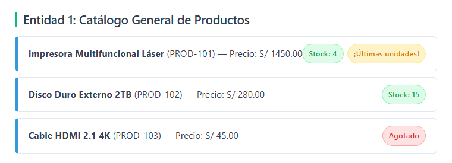

La consola del navegador no muestra advertencias de `key` ni de otro tipo, y
`oxlint` no reporta problemas.

## Ejercicio 4 — Crear un componente contenedor con children

### 1. El componente `Tarjeta`

```jsx
// frontend/src/components/Tarjeta.jsx
function Tarjeta({ titulo, children }) {
  return (
    <div className="card-pedido">
      {titulo && <h3>{titulo}</h3>}
      {children}
    </div>
  );
}

export default Tarjeta;
```

- **`titulo`** es una prop normal. Si llega, se dibuja como `<h3>`; si no, la
  tarjeta se muestra sin cabecera (`titulo && ...`).
- **`children`** es una prop especial que React llena automáticamente con
  **todo lo que se escribe entre la etiqueta de apertura y la de cierre**,
  `<Tarjeta>...aquí...</Tarjeta>`. La tarjeta no sabe ni le importa qué
  contenido recibe: solo lo coloca dentro de su marco.
- **El estilo** (`.card-pedido`: fondo blanco, borde, sombra, bordes
  redondeados) vive en un solo lugar. Cualquier contenido envuelto en
  `<Tarjeta>` se ve como una tarjeta.

A diferencia de `TarjetaProducto`, que sabe dibujar un producto concreto,
`Tarjeta` es un componente **contenedor genérico**: define el marco y deja el
contenido a quien lo usa. Se puede reutilizar para registros de entidades
distintas.

### 2. Uso en `App.jsx`

Se usó para envolver **cada registro** de las dos relaciones 1:N, que antes
repetían `<div className="card-pedido"><h3>...</h3>...</div>`:

```jsx
import Tarjeta from './components/Tarjeta'

// Pedidos (parte guiada)
<Tarjeta key={pedido.id} titulo={`Pedido #${pedido.id} — Cliente: ${pedido.cliente}`}>
  <p>Fecha: {pedido.fecha} | Estado: <strong>{pedido.estado}</strong></p>
  <h4>Detalles de Items:</h4>
  <ul className="lista-detalles">
    {pedido.detalles.map((det) => (
      <li key={det.id}>...</li>
    ))}
  </ul>
  <p>Total calculado: S/ {totalPedido.toFixed(2)}</p>
</Tarjeta>

// Categorías (investigación propia)
<Tarjeta key={cat.id} titulo={`Categoría #${cat.id}: ${cat.nombre}`}>
  <p>{cat.descripcion}</p>
  <h4>Productos pertenecientes a esta categoría (...)</h4>
  <ul className="lista-detalles">...</ul>
  <p>Valor Total del Stock en Categoría: S/ ...</p>
</Tarjeta>
```

El mismo contenedor recibe contenido distinto en cada caso: un pedido con sus
detalles, o una categoría con sus productos, conteo y total. En ambos casos
todo lo que está entre `<Tarjeta>` y `</Tarjeta>` llega como `children`. El
título usa *template literals* (`` `Pedido #${pedido.id}` ``) para armar un
solo texto con varios datos. La `key` se coloca en `<Tarjeta>` porque es el
elemento que devuelve el `map()`.

### 3. Resultado en el navegador

Las tarjetas se ven igual que antes, que era lo esperado: el estilo no cambió,
solo se centralizó. En el navegador se comprobó que las 4 tarjetas
`.card-pedido` (2 pedidos y 2 categorías) contienen el `<h3>` generado desde
`titulo` seguido del contenido pasado como `children` (`P, H4, UL, P`).

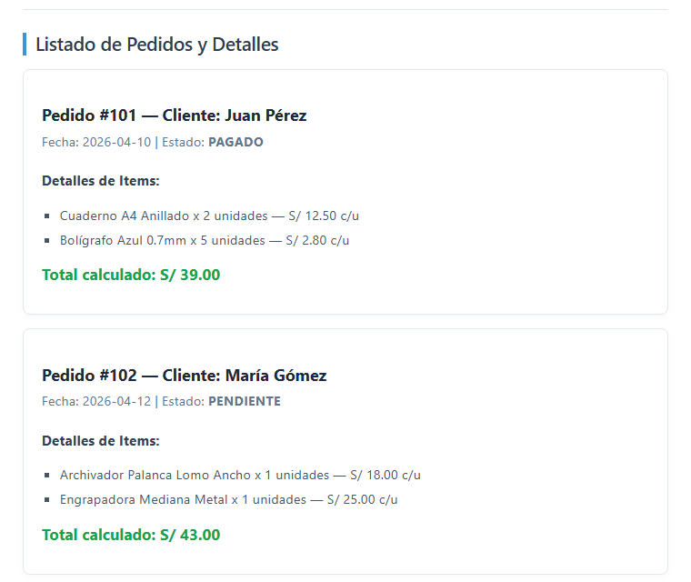

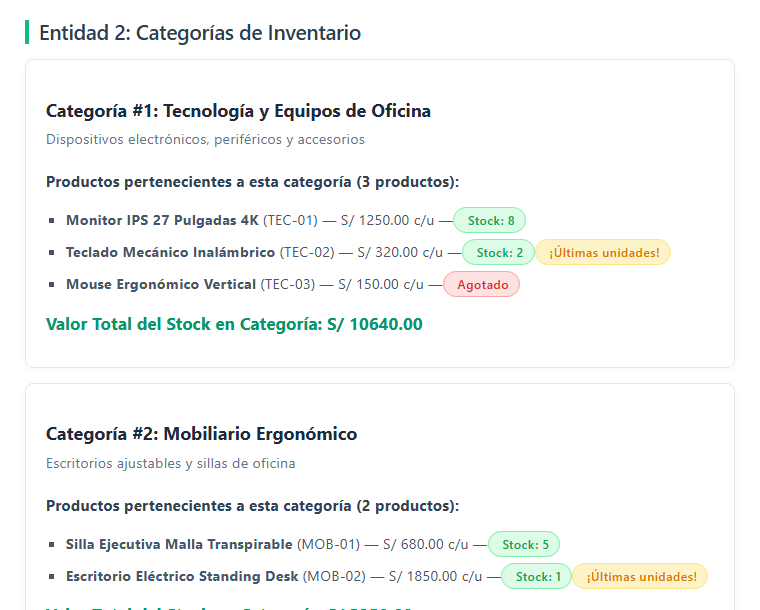

### 4. ¿Qué equivalente tiene `children` en los Templates de Django (Semana 6)?

En la Semana 6 la plantilla base `utileria/base.html` definía la estructura
común (navbar, `<main>`, footer) y dejaba un **hueco** para que cada página lo
llenara:

```django
{# semana-06/src/utileria/templates/utileria/base.html #}
<main class="container flex-grow-1">
    
    
</main>
```

Cada página heredaba esa base y llenaba el hueco:

```django
{# semana-06/src/utileria/templates/utileria/pedido_list.html #}



<h2 class="mb-4">Registro de Pedidos</h2>
...

```

**`children` es el equivalente de ``.** En los dos casos hay
un "marco" que define la estructura y el estilo, y deja un espacio que llena
quien lo usa:

| Django (Semana 6) | React (Semana 10) |
|---|---|
| `base.html` (plantilla padre) | `Tarjeta.jsx` (componente contenedor) |
| `` (el hueco) | `{children}` (el hueco) |
| `` + `...` | `<Tarjeta>...</Tarjeta>` |
| `` (un segundo hueco con nombre) | la prop `titulo` |

**Diferencias:**
- En Django el marco suele ser **la página completa** y se usa una vez por
  página con `extends`. En React el contenedor puede ser **cualquier pedazo** de
  la interfaz y se puede usar muchas veces en la misma pantalla, incluso dentro
  de un `map()`, como aquí con una tarjeta por pedido.
- Django resuelve el template **en el servidor** y envía HTML ya armado. React
  arma la vista **en el navegador**, y `children` es un valor de JavaScript
  (elementos JSX) que se puede pasar, guardar o condicionar como cualquier otro.
- Django permite varios bloques con nombre (`title`, `content`...). En React
  hay un solo `children`, y los demás "huecos" se pasan como props normales,
  como `titulo`.

Por otro lado, ``, que la Semana 6
usaba en `producto_list.html`, se parece más a un componente **sin** children
como `TarjetaProducto`: inserta un fragmento ya definido que usa las variables
del contexto, del mismo modo que el componente usa sus props.

## Ejercicio 5 — Componentes dentro de componentes: la relación 1:N

### 1. Estructura

La relación 1:N **Pedido → DetallePedido** se dibuja ahora con componentes que
se usan unos dentro de otros:

```
App
└── DetallePedido  (uno por pedido; calcula el total)
    └── Tarjeta     (contenedor del Ejercicio 4)
        └── ItemDetalle  (uno por cada detalle del pedido)
```

### 2. `ItemDetalle`: el elemento anidado

```jsx
// frontend/src/components/ItemDetalle.jsx
function ItemDetalle({ nombreProducto, cantidad, precioUnitario }) {
  const subtotal = cantidad * Number(precioUnitario);

  return (
    <li>
      {nombreProducto} x {cantidad} {cantidad === 1 ? 'unidad' : 'unidades'} — S/ {Number(precioUnitario).toFixed(2)} c/u
      {' '}= <strong>S/ {subtotal.toFixed(2)}</strong>
    </li>
  );
}

export default ItemDetalle;
```

Representa **un** detalle. Calcula su subtotal y además corrige el plural:
ahora muestra "1 unidad" en lugar de "1 unidades".

### 3. `DetallePedido`: el registro padre con su total

```jsx
// frontend/src/components/DetallePedido.jsx
import Tarjeta from './Tarjeta';
import ItemDetalle from './ItemDetalle';

function DetallePedido({ pedido }) {
  const total = pedido.detalles.reduce(
    (acc, det) => acc + det.cantidad * Number(det.precio_unitario),
    0
  );

  return (
    <Tarjeta titulo={`Pedido #${pedido.id} — Cliente: ${pedido.cliente}`}>
      <p>Fecha: {pedido.fecha} | Estado: <strong>{pedido.estado}</strong></p>

      <h4>Detalles de Items ({pedido.detalles.length}):</h4>
      <ul className="lista-detalles">
        {pedido.detalles.map((det) => (
          <ItemDetalle
            key={det.id}
            nombreProducto={det.producto_nombre}
            cantidad={det.cantidad}
            precioUnitario={det.precio_unitario}
          />
        ))}
      </ul>

      <p className="total-calculado">Total calculado: S/ {total.toFixed(2)}</p>
    </Tarjeta>
  );
}

export default DetallePedido;
```

- **Componentes anidados:** `DetallePedido` usa `Tarjeta` como marco y, dentro,
  un `ItemDetalle` por cada elemento de `pedido.detalles`, con `map()` y
  `key={det.id}`.
- **Total calculado con JavaScript:** `reduce()` recorre los detalles y suma
  `cantidad × precio_unitario`. `Number()` hace falta porque la API (DRF,
  Semana 8) envía los `DecimalField` como texto (`"12.50"`). El total se
  calcula en el padre porque es el único que conoce **todos** los detalles.
- **El estilo** del total pasó del `style={{ }}` en línea a la clase
  `.total-calculado` de `App.css`.

En `App.jsx` todo el bloque de pedidos (unas 25 líneas) quedó así:

```jsx
import DetallePedido from './components/DetallePedido'

{pedidos.map((pedido) => (
  <DetallePedido key={pedido.id} pedido={pedido} />
))}
```

### 4. Conversión de nombres: de la API a las props

Los datos imitan la respuesta de la API de Django REST Framework, que usa
nombres en **snake_case** (el estilo de Python). En React las props se
escriben en **camelCase** (el estilo de JavaScript). La conversión se hace en
un solo lugar, donde el padre crea al hijo:

| Campo en la API (DRF) | Prop de `ItemDetalle` |
|---|---|
| `producto_nombre` | `nombreProducto` |
| `precio_unitario` | `precioUnitario` |
| `cantidad` | `cantidad` (no necesita cambio) |

Así `ItemDetalle` no depende de cómo se llaman los campos en el backend. Si el
serializer cambia un nombre, solo hay que corregir la línea de `DetallePedido`
que hace la conversión, y el componente hijo no cambia.

### 5. Resultado en el navegador

Cada pedido muestra sus detalles con el subtotal por línea y el total
calculado. Los totales (S/ 39.00 y S/ 43.00) coinciden con los de la Semana 9.

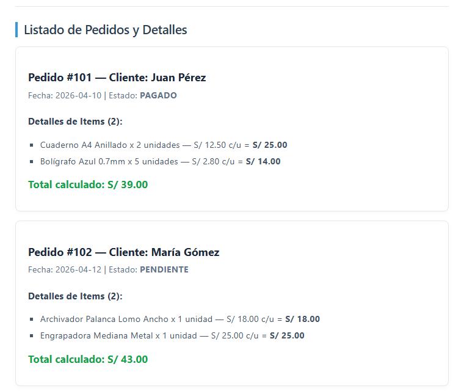

### 6. ¿Por qué un componente no debe modificar sus props?

Las props son los **datos que el padre le presta al hijo**. El hijo puede
leerlas, pero no le pertenecen: el dueño es el padre, que las puede volver a
enviar en cualquier momento.

- **Flujo de datos en un solo sentido.** En React los datos bajan del padre al
  hijo. Si el hijo cambiara sus props, el padre tendría un valor y el hijo
  otro. La pantalla dejaría de reflejar los datos reales y sería muy difícil
  saber quién cambió qué.
- **Funciones puras.** React espera que un componente, con las mismas props,
  devuelva siempre el mismo JSX. Como React puede ejecutar un componente
  muchas veces (en modo desarrollo con `StrictMode` lo hace dos veces a
  propósito), un cambio dentro de la función se acumularía: la cantidad
  sumaría +1 en cada renderizado.
- **Los cambios no se ven.** Aunque se pudiera modificar una prop, React no se
  enteraría y no volvería a dibujar. Para datos que cambian existe el
  **estado** (`useState`), que pertenece al componente y avisa a React para
  que vuelva a renderizar. Si un hijo necesita cambiar algo del padre, el
  padre le pasa una función por props y el hijo la llama.

### 7. Prueba: ¿qué mensaje aparece si se intenta?

Se cambió `ItemDetalle` de forma temporal para que intentara modificar una de
sus props (después se restauró):

```jsx
function ItemDetalle(props) {
  props.cantidad = props.cantidad + 1;   // ← intento de modificar una prop
  ...
}
```

Mensaje en la consola del navegador (registro completo en
[`capturas/ej5-consola-modificar-props.txt`](capturas/ej5-consola-modificar-props.txt)):

```
Uncaught TypeError: Cannot assign to read only property 'cantidad' of object '#<Object>'

An error occurred in the <ItemDetalle> component. Consider adding an error boundary
to your tree to customize error handling behavior.
```

**Qué significa:** en modo desarrollo React **congela** el objeto `props`
(`Object.freeze`), así que sus propiedades son de **solo lectura**. Los
módulos de JavaScript se ejecutan en modo estricto, por lo que asignar a una
propiedad de solo lectura no se ignora en silencio: lanza un `TypeError`. Como
no hay un *error boundary* que lo capture, React desmonta todo el árbol y **la
página entera queda en blanco**: `<div id="root">` queda vacío. Un solo error en
un componente pequeño tumba toda la aplicación.


**Detalle importante:** React congela solo el objeto `props`, y no lo que hay
dentro. Si `DetallePedido` hiciera `pedido.estado = "X"`, **no** aparecería
ningún error, porque `pedido` es un objeto normal. Pero se estaría modificando
el arreglo original de `datos.js`, y ese cambio afectaría a cualquier otro
componente que use ese pedido. Por eso la regla es **tratar las props como de
solo lectura siempre**, aunque React no lo detecte.

## Ejercicio 6 — Agregar estado y un evento de clic

### 1. Código

Se modificó `TarjetaProducto`, el componente del registro de la entidad
principal:

```jsx
// frontend/src/components/TarjetaProducto.jsx
import { useState } from 'react';

function TarjetaProducto({ nombre, codigo, precio, stock = 0, limiteUltimas = 3 }) {
  const [cantidad, setCantidad] = useState(0);

  const sinStock = stock === 0;
  const limiteAlcanzado = cantidad >= stock;

  function agregar() {
    setCantidad(cantidad + 1);
  }

  return (
    <li className="item-producto">
      {/* ...nombre, código, precio y badges de stock... */}

      {cantidad > 0 && (
        <span className="contador-seleccion">Seleccionados: {cantidad}</span>
      )}

      <button
        type="button"
        className="btn-agregar"
        onClick={agregar}
        disabled={sinStock || limiteAlcanzado}
      >
        {sinStock ? 'Sin stock' : limiteAlcanzado ? 'Máximo' : '+ Agregar'}
      </button>
    </li>
  );
}
```

- **`useState(0)`** crea un estado local que empieza en 0. Devuelve un par: el
  valor actual (`cantidad`) y la función para cambiarlo (`setCantidad`).
- **Evento de clic:** `onClick={agregar}` pasa la **función** sin ejecutarla (sin
  paréntesis). React la llama cuando el usuario hace clic. Dentro, `setCantidad`
  guarda el nuevo valor y le pide a React que vuelva a dibujar el componente.
- **Mostrar el contador solo si es mayor que cero:** `cantidad > 0 && (...)`.
  Con 0 la expresión es `false` y React no dibuja nada.
- **Desactivar según un campo del registro:** el botón usa `disabled` según
  `stock`:
  - `stock === 0` → el producto está agotado, y el botón muestra "Sin stock"
    desactivado desde el principio.
  - `cantidad >= stock` → no se pueden seleccionar más unidades de las que hay,
    y el botón pasa a "Máximo" y se desactiva.
- Los estilos `.btn-agregar` (incluido `:disabled`) y `.contador-seleccion` se
  agregaron a `App.css`.

### 2. Cada componente conserva su propio contador

Prueba en el navegador: 2 clics en el *Cuaderno* de la sección "Componente
TarjetaProducto", 3 clics en el *Bolígrafo* (stock 3) y 1 clic en el *Cuaderno*
del "Listado de Productos":

| Tarjeta | Clics | Resultado |
|---|---|---|
| Cuaderno A4 (sección Componente) | 2 | `Seleccionados: 2`, botón activo |
| Corrector Líquido (stock por defecto 0) | — | sin contador, botón "Sin stock" desactivado |
| Cuaderno A4 (Listado) | 1 | `Seleccionados: 1` |
| Bolígrafo Azul (stock 3) | 3 | `Seleccionados: 3`, botón "Máximo" desactivado |
| Resaltador (stock 0) | — | sin contador, botón "Sin stock" desactivado |
| Archivador, Engrapadora | 0 | contador oculto |

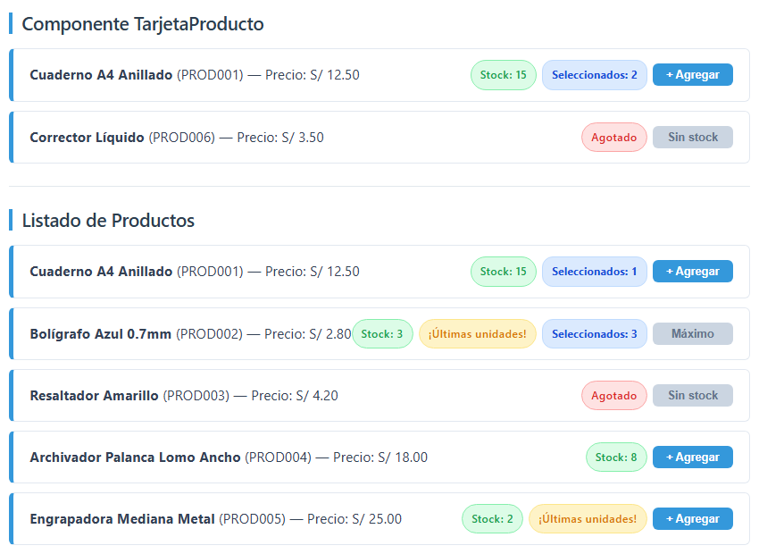

Los dos *Cuaderno A4* muestran el **mismo producto** con las **mismas props**,
pero uno marca 2 y el otro 1. El estado no pertenece al dato, sino a **cada
instancia** del componente. Cada vez que React dibuja un
`<TarjetaProducto />`, le reserva su propia "memoria" para `useState`, así que
un clic en una tarjeta no afecta a las demás.

### 3. ¿Por qué una variable normal (`let`) no actualiza la pantalla?

Se probó cambiando el estado por una variable normal de forma temporal (luego
se restauró `useState`):

```jsx
let cantidad = 0;

function agregar() {
  cantidad = cantidad + 1;
  console.log(`[let] ${nombre}: cantidad = ${cantidad}`);
}
```

Después de 3 clics en el *Cuaderno A4*
([registro completo](capturas/ej6-consola-let.txt)):

```
[let] Cuaderno A4 Anillado: cantidad = 1
[let] Cuaderno A4 Anillado: cantidad = 2
[let] Cuaderno A4 Anillado: cantidad = 3
```

La variable **sí cambia**, pero la tarjeta sigue igual: nunca aparece
"Seleccionados".

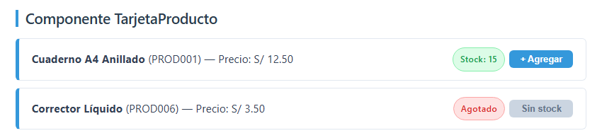

**Explicación:**

1. **React no se entera.** Un componente es una función que React ejecuta para
   obtener el JSX. React solo vuelve a ejecutarla (re-renderiza) cuando algo se
   lo pide, y `setCantidad` es justamente ese aviso. Cambiar una variable con
   `cantidad = cantidad + 1` es JavaScript normal: el valor cambia en memoria,
   pero nadie le dice a React que la pantalla está desactualizada.
2. **Aunque se volviera a dibujar, se perdería el valor.** La variable `let` se
   crea de nuevo **cada vez que se ejecuta la función** del componente. Si React
   re-renderizara la tarjeta por otro motivo, se ejecutaría otra vez
   `let cantidad = 0` y el conteo volvería a cero. `useState`, en cambio, guarda
   el valor **fuera** de la función, en la memoria que React reserva para esa
   instancia, y lo devuelve en cada render.

En resumen, `useState` hace dos cosas que `let` no puede hacer: **recuerda** el
valor entre renders y **avisa** a React para que vuelva a dibujar.

## Ejercicio 7 — Un campo controlado que filtra la lista

### 1. Código

La búsqueda se agregó en `ListaProductos`, el componente que contiene la
lista:

```jsx
// frontend/src/components/ListaProductos.jsx
import { useState } from 'react';
import TarjetaProducto from './TarjetaProducto';

function ListaProductos({ productos, limiteUltimas, mensajeVacio = "No hay registros de productos disponibles." }) {
  const [busqueda, setBusqueda] = useState('');

  if (productos.length === 0) {
    return <p className="alerta-vacio">{mensajeVacio}</p>;
  }

  const texto = busqueda.trim().toLowerCase();
  const filtrados = productos.filter((prod) =>
    prod.nombre.toLowerCase().includes(texto)
  );

  return (
    <div className="contenedor-lista">
      <div className="buscador">
        <input
          type="search"
          className="campo-busqueda"
          placeholder="Buscar producto por nombre..."
          value={busqueda}
          onChange={(e) => setBusqueda(e.target.value)}
        />
        <span className="conteo-busqueda">
          Mostrando {filtrados.length} de {productos.length}
        </span>
      </div>

      {filtrados.length === 0 ? (
        <p className="alerta-vacio">Ningún producto coincide con "{busqueda}".</p>
      ) : (
        <ul className="lista-productos">
          {filtrados.map((prod) => (
            <TarjetaProducto key={prod.id} nombre={prod.nombre} /* ...demás props... */ />
          ))}
        </ul>
      )}
    </div>
  );
}
```

**Campo controlado.** El `<input>` no guarda su propio valor: lo guarda React
en el estado `busqueda`.
- **`value={busqueda}`**: lo que se ve en el campo es siempre lo que tiene el
  estado.
- **`onChange={(e) => setBusqueda(e.target.value)}`**: en cada tecla, `e` es el
  evento, `e.target` es el `<input>` y `e.target.value` es el texto que tiene
  en ese momento. Ese texto se guarda en el estado, React vuelve a renderizar y
  el campo muestra el nuevo valor.
- Así hay **una sola fuente de verdad**: el estado. Con ese mismo valor se
  calcula la lista filtrada en el mismo render.

**Filtro sin distinguir mayúsculas de minúsculas.** El texto buscado y el
nombre de cada producto se pasan a minúsculas con `toLowerCase()` antes de
comparar con `includes()`. Así, "CUADERNO", "cuaderno" y "CuAdErNo" encuentran
lo mismo. `trim()` ignora los espacios al inicio y al final. Con el campo
vacío, `includes('')` es `true` para todos y se muestra la lista completa.

**Detalles de diseño:**
- `filtrados` **no es un estado**, sino un valor **calculado** a partir de las
  props (`productos`) y del estado (`busqueda`). Guardarlo en otro `useState`
  duplicaría datos que podrían desincronizarse.
- Hay **dos mensajes distintos**: `mensajeVacio`, cuando el arreglo original
  no tiene registros, y "Ningún producto coincide con…", cuando sí hay
  registros pero ninguno pasa el filtro.
- "Mostrando X de Y" da retroalimentación inmediata mientras se escribe.
- Como `ListaProductos` se usa dos veces (Listado guiado y Entidad 1), **cada
  lista tiene su propio buscador independiente**, por el mismo motivo que los
  contadores del Ejercicio 6: cada instancia tiene su propio estado.
- Los estilos (`.buscador`, `.campo-busqueda`, `.conteo-busqueda`) están en
  `App.css`.

### 2. Búsquedas y resultados

Pruebas hechas en el "Listado de Productos" (5 registros):

| # | Texto buscado | Resultado | Productos mostrados |
|---|---|---|---|
| 1 | `CUADERNO` | Mostrando 1 de 5 | Cuaderno A4 Anillado |
| 2 | `ar` | Mostrando 2 de 5 | Resalt**ar**… Am**ar**illo, **Ar**chivador Palanca Lomo Ancho |
| — | `tijera` | Mostrando 0 de 5 | *Mensaje: Ningún producto coincide con "tijera".* |

**Búsqueda 1 — `CUADERNO` (en mayúsculas).** El producto se llama "Cuaderno
A4 Anillado", con minúsculas, y aun así coincide. Esto demuestra que el filtro
no distingue mayúsculas de minúsculas.

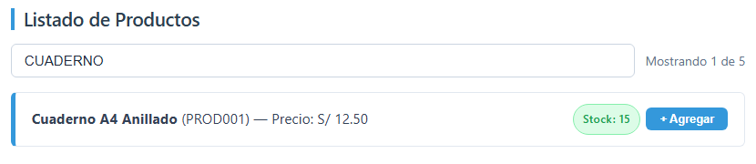

**Búsqueda 2 — `ar`.** Busca el texto en cualquier parte del nombre, no solo
al inicio. Encuentra "Resaltador Amarillo" (en *Amarillo*) y "Archivador
Palanca Lomo Ancho" (en *Archivador*, que empieza con mayúscula "Ar"). Las
otras 3 tarjetas se ocultan.

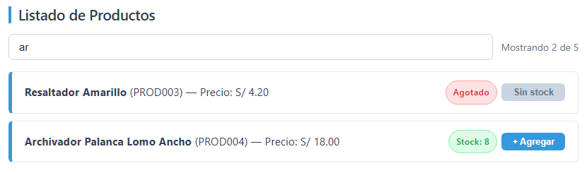

**Sin coincidencias — `tijera`.** No existe ningún producto con ese nombre, así
que en lugar de una lista vacía se muestra el mensaje.

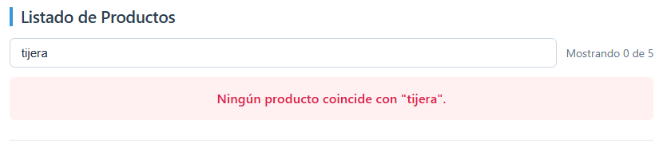

**Observación:** la comparación sí distingue **tildes**. Por ejemplo,
`boligrafo` sin tilde no encuentra "Bolígrafo". Para ignorarlas se podría
normalizar el texto con `normalize('NFD').replace(/[\u0300-\u036f]/g, '')`
antes de comparar, pero el ejercicio solo pedía ignorar mayúsculas y
minúsculas.

## Ejercicio 8 — Formulario controlado con onSubmit y validación

### 1. La lista pasa a vivir en el estado (`App.jsx`)

Hasta el Ejercicio 7, `ListaProductos` recibía el arreglo fijo importado de
`datos.js`. Para poder **agregar** registros, la lista tiene que ser un estado.
El arreglo de `datos.js` queda solo como **valor inicial**:

```jsx
// frontend/src/App.jsx
import { useState } from 'react'
import FormularioProducto from './components/FormularioProducto'

function App() {
  const [listaProductos, setListaProductos] = useState(productos);

  const agregarProducto = (nuevo) => {
    const siguienteId = Math.max(0, ...listaProductos.map((p) => p.id)) + 1;
    setListaProductos([...listaProductos, { id: siguienteId, ...nuevo }]);
  };

  // ...
  <Tarjeta titulo="Registrar nuevo producto">
    <FormularioProducto onAgregar={agregarProducto} />
  </Tarjeta>

  <ListaProductos productos={listaProductos} />
}
```

**¿Por qué un arreglo nuevo y no `push`?** `push` **modifica** el arreglo
existente: la variable sigue apuntando al **mismo** arreglo en memoria. React
decide si debe volver a dibujar comparando la referencia anterior con la nueva
(`Object.is`). Si es el mismo arreglo, React concluye que "nada cambió" y la
pantalla no se actualiza. Con `[...listaProductos, nuevo]`, el *spread*
(`...`) copia los elementos actuales en un arreglo **nuevo** y agrega el
producto al final. La referencia cambia, React lo detecta y vuelve a dibujar.
Además se respeta la regla de no modificar el estado directamente, igual que
con las props del Ejercicio 5.

El `id` se calcula como el mayor existente + 1, porque `key` necesita un valor
único. Es un id **temporal**: el verdadero lo asignaría la base de datos (ver
la sección 6).

**Patrón "levantar el estado".** La lista vive en `App`, el padre común. El
formulario **no** modifica la lista: recibe la función `onAgregar` por props y
la llama con los datos nuevos. `App` es el único que cambia el estado y pasa
la lista actualizada a `ListaProductos`.

### 2. El formulario (`FormularioProducto.jsx`)

```jsx
// frontend/src/components/FormularioProducto.jsx
import { useState } from 'react';

const formularioVacio = { codigo: '', nombre: '', precio: '', stock: '' };

function validar(datos) {
  const errores = {};
  // ...código y nombre: obligatorios y con longitud máxima...
  if (datos.precio === '' || Number(datos.precio) <= 0) {
    errores.precio = 'El precio debe ser mayor que cero.';
  }
  // ...stock: entero mayor o igual a 0...
  return errores;
}

function FormularioProducto({ onAgregar }) {
  const [datos, setDatos] = useState(formularioVacio);
  const [errores, setErrores] = useState({});
  const [mensajeExito, setMensajeExito] = useState('');

  function manejarCambio(e) {
    const { name, value } = e.target;
    setDatos({ ...datos, [name]: value });
    setMensajeExito('');
  }

  function manejarEnvio(e) {
    e.preventDefault();

    const nuevosErrores = validar(datos);
    setErrores(nuevosErrores);

    if (Object.keys(nuevosErrores).length > 0) {
      setMensajeExito('');
      return;
    }

    onAgregar({
      codigo: datos.codigo.trim(),
      nombre: datos.nombre.trim(),
      precio: Number(datos.precio).toFixed(2),
      stock: Number(datos.stock),
    });

    setMensajeExito(`Producto "${datos.nombre.trim()}" agregado a la lista.`);
    setDatos(formularioVacio);
  }

  return (
    <form className="form-producto" onSubmit={manejarEnvio} noValidate>
      <label className="form-campo">
        Código
        <input name="codigo" value={datos.codigo} onChange={manejarCambio} placeholder="Ej.: PROD006" />
        {errores.codigo && <span className="form-error">{errores.codigo}</span>}
      </label>
      {/* ...nombre, precio y stock con la misma estructura... */}
      <button type="submit" className="btn-guardar">Agregar producto</button>
      {mensajeExito && <p className="form-exito">{mensajeExito}</p>}
    </form>
  );
}
```

- **Campos controlados (4).** Cada `<input>` tiene `value` tomado del estado
  `datos` y `onChange={manejarCambio}`. Un solo manejador sirve para todos:
  usa el atributo `name` del input (`e.target.name`) como clave y
  `e.target.value` como valor. `{ ...datos, [name]: value }` crea un objeto
  **nuevo** que solo cambia ese campo, sin modificar el anterior.
- **`onSubmit` en el `<form>`**, no `onClick` en el botón. Así el formulario
  también se envía al presionar Enter en cualquier campo.
- **`e.preventDefault()`**: por defecto, enviar un formulario HTML **recarga la
  página** (hace una petición GET/POST a la URL del `action`). Eso borraría todo
  el estado de React. `preventDefault()` cancela ese comportamiento y deja que
  React maneje el envío.
- **Limpiar los campos.** Después de un envío válido,
  `setDatos(formularioVacio)` devuelve el estado a cadenas vacías. Como los
  inputs son controlados, se vacían solos. Si hay errores **no** se limpia, para
  que el usuario corrija sin volver a escribir todo.
- **`noValidate`** desactiva los globos de validación nativos del navegador, para
  que los mensajes sean los mismos que los de la API.

### 3. Validación basada en la API de la Semana 8

La regla principal viene de `ProductoSerializer` en
`semana-08/src/utileria/serializers.py`:

```python
# Regla de negocio: El precio debe ser estrictamente mayor que 0
def validate_precio(self, value):
    if value <= 0:
        raise serializers.ValidationError("El precio debe ser mayor que cero.")
    return value
```

El formulario aplica la **misma regla con el mismo mensaje**. Además valida
restricciones que vienen del modelo `Producto` de esa semana:

| Campo | Regla en el formulario | Origen en Django (Semana 8) |
|---|---|---|
| `precio` | `> 0` → "El precio debe ser mayor que cero." | `ProductoSerializer.validate_precio` |
| `codigo` | obligatorio, máx. 20 caracteres | `codigo = models.CharField(max_length=20)` |
| `nombre` | obligatorio, máx. 100 caracteres | `nombre = models.CharField(max_length=100)` |
| `stock` | entero `>= 0` | `stock = models.IntegerField()` |

### 4. Pruebas en el navegador

**Envío con errores.** Código vacío, precio `0` y stock `2.5`. Se muestran los
tres mensajes debajo de cada campo y **no** se agrega nada: el listado sigue en
"Mostrando 5 de 5". La URL no cambia y los datos escritos se conservan, lo que
confirma que `preventDefault()` evitó la recarga.

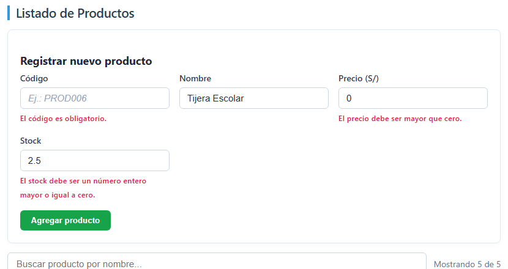

**Envío correcto.** `PROD006` · `Tijera Escolar` · `5.50` · `10`. El producto
aparece al final de la lista ("Mostrando 6 de 6"), con su badge de stock y su
botón del Ejercicio 6. Aparece el mensaje de éxito y los cuatro campos quedan
vacíos (solo se ven los *placeholders* "Ej.: …").

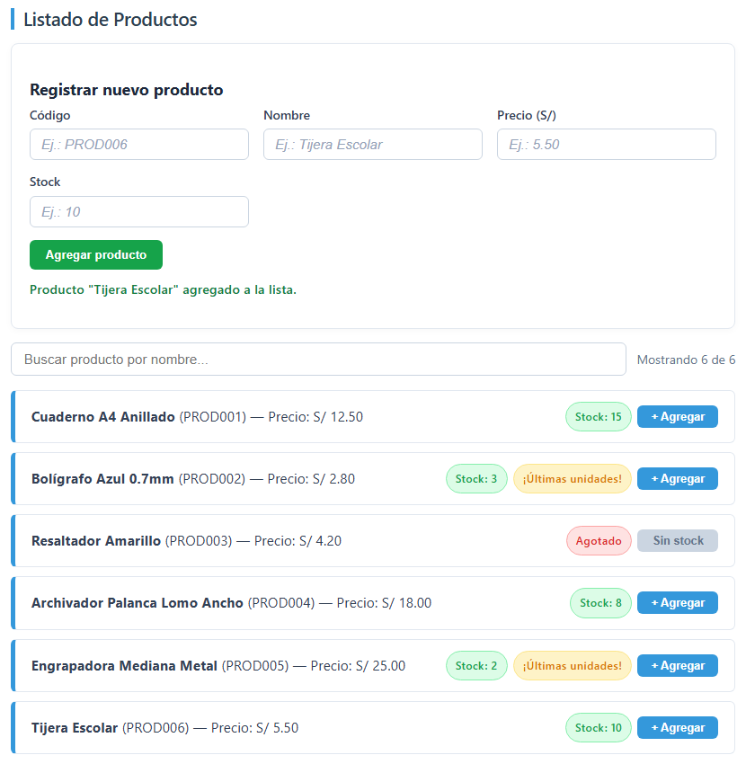

El producto nuevo también aparece en el buscador del Ejercicio 7, porque
`ListaProductos` filtra lo que recibe por props, que ahora es el estado.

### 5. `npm run lint` y `npm run build`

```
PS semana-10\frontend> npm run lint

> frontend@0.0.0 lint
> oxlint

Found 0 warnings and 0 errors.
Finished in 30ms on 10 files with 104 rules using 16 threads.
```

```
PS semana-10\frontend> npm run build

> frontend@0.0.0 build
> vite build

vite v8.3.4 building client environment for production...
transforming...
✓ 24 modules transformed.
rendering chunks...
computing gzip size...
dist/index.html                   0.45 kB │ gzip:  0.29 kB
dist/assets/index-CsEbDO8i.css    5.50 kB │ gzip:  1.88 kB
dist/assets/index-HoN5-xUX.js   230.13 kB │ gzip: 71.92 kB

✓ built in 367ms
```

Los dos comandos terminan con código de salida 0. Las salidas completas están
en [`capturas/ej8-npm-run-lint.txt`](capturas/ej8-npm-run-lint.txt) y
[`capturas/ej8-npm-run-build.txt`](capturas/ej8-npm-run-build.txt).

- **Lint:** `oxlint` revisó los 10 archivos del proyecto con las reglas de
  `.oxlintrc.json`, incluida `react/rules-of-hooks`, que verifica que
  `useState` se llame solo en el nivel superior de los componentes. No
  encontró advertencias ni errores.
- **Build:** Vite empaquetó los 24 módulos en un HTML, un CSS y un JS
  minificados dentro de `frontend/dist/`. Esa carpeta es la que se publicaría en
  un servidor. El JS pesa 230 kB, o 72 kB comprimido con gzip, y la mayor parte
  corresponde a React.

### 6. ¿Qué falta para guardar el registro en la base de datos de Django?

Ahora el producto solo existe **en la memoria del navegador**, en el estado de
`App`. Al recargar la página, `useState(productos)` vuelve a empezar desde
`datos.js` y la *Tijera Escolar* desaparece. Para que se guarde en la base de
datos (SQLite) de la Semana 8 falta:

1. **Enviar el registro a la API con `fetch`.** En `agregarProducto`, en lugar
   de solo actualizar el estado, hay que hacer un `POST` al endpoint del
   `ProductoViewSet`:
   ```js
   const respuesta = await fetch('http://127.0.0.1:8000/api/productos/', {
     method: 'POST',
     headers: { 'Content-Type': 'application/json' },
     body: JSON.stringify(nuevo), // { codigo, nombre, precio, stock }
   });
   ```
   Los nombres de los campos ya coinciden con los `fields` del
   `ProductoSerializer` (`codigo`, `nombre`, `precio`, `stock`), y `categoria`
   es opcional (`null=True, blank=True`).

2. **Habilitar CORS en Django.** React corre en `localhost:5173` y Django en
   `127.0.0.1:8000`. Son **orígenes distintos**, y el navegador bloquea la
   petición si Django no lo permite expresamente. El proyecto de la Semana 8 no
   tiene configurado CORS. Hay que instalar `django-cors-headers` y agregarlo a
   `INSTALLED_APPS` y `MIDDLEWARE`, con
   `CORS_ALLOWED_ORIGINS = ['http://localhost:5173']`.

3. **Usar la respuesta del servidor.** Si DRF responde **201 Created**, devuelve
   el producto guardado con su **`id` real** de la base de datos. Ese es el
   objeto que se debe agregar al estado (con el mismo
   `[...lista, productoGuardado]`), en lugar del id temporal calculado en el
   navegador.

4. **Mostrar los errores del servidor.** Si DRF responde **400 Bad Request**,
   envía los errores del serializer por campo, por ejemplo
   `{"precio": ["El precio debe ser mayor que cero."]}`. Ese objeto tiene la
   misma forma que el estado `errores` del formulario, así que se puede mostrar
   igual. La validación en React es solo para **comodidad del usuario**: la
   validación que realmente protege la base de datos es la del serializer, porque
   cualquiera podría saltarse el formulario y llamar a la API directamente.

5. **Cargar la lista inicial desde la API.** En lugar de `datos.js`, la lista
   debería venir de un `GET /api/productos/` cuando el componente se monta
   (con `useEffect`). Así la página muestra lo que realmente hay en la base de
   datos, incluido lo agregado en visitas anteriores.

6. **Manejar la espera.** `fetch` es asíncrono. Conviene un estado "guardando…"
   que desactive el botón mientras llega la respuesta, para evitar envíos
   duplicados, y avisar si el servidor no responde. Si más adelante la API
   exige autenticación, también habría que enviar el token o la cookie con
   CSRF.

## Ejercicio 9 — Identificar los componentes de la investigación propia

### 1. Entidad de la investigación propia

La investigación propia sigue la entidad **Categoría**, la misma que se trabajó
en semanas anteriores:

- **Semana 8 (API DRF):** recurso `/api/categorias/` con `CategoriaViewSet` y
  `CategoriaSerializer` (`fields = ['id', 'nombre', 'descripcion']`). El modelo
  es `Categoria(nombre = CharField(max_length=100), descripcion = TextField(blank=True, null=True))`.
  Tiene una relación **1:N** con `Producto` mediante
  `Producto.categoria = ForeignKey(Categoria, related_name='productos')`.
- **Semana 9 / 10 (React):** sección "Entidad 2: Categorías de Inventario" en
  `App.jsx`. Usa el arreglo `categorias` de `datos.js`, donde cada categoría
  tiene sus `productos` anidados. Hoy está escrita directamente en `App.jsx` con
  `map()` y con la `Tarjeta` del Ejercicio 4.

### 2. Tabla de equivalencias

| Elemento | Parte guiada (ya construido) | Investigación propia (Categorías) |
|---|---|---|
| **Componente que muestra un registro** | `TarjetaProducto` — nombre, código, precio y badges de stock | **`TarjetaCategoria`** — props desestructuradas `{ nombre, descripcion = "Sin descripción", productos }`. Muestra el nombre, la descripción y el conteo de productos. El **valor por defecto** de `descripcion` responde a que en el modelo es opcional (`blank=True, null=True`). |
| **Lista de registros (`map` + `key`)** | `ListaProductos` con `key={prod.id}` | **`ListaCategorias`** — recibe el arreglo `categorias` y crea una `TarjetaCategoria` por cada una con `key={cat.id}`, con mensaje si la lista está vacía. |
| **Contenedor con `children`** | `Tarjeta` (envuelve pedidos y categorías) | Se **reutiliza** `Tarjeta` como marco de cada categoría, con `titulo={`Categoría #${id}: ${nombre}`}`. |
| **Botón con estado (`useState` + `onClick`)** | Botón "+ Agregar" con contador `cantidad`, que se muestra solo si es > 0 y se desactiva si `stock === 0` o `cantidad >= stock` | Botón **"Ver productos (n)" / "Ocultar productos"** en `TarjetaCategoria`, con `const [abierta, setAbierta] = useState(false)`. Al hacer clic alterna `setAbierta(!abierta)` y la lista anidada se muestra solo si `abierta` es `true`. Se **desactiva** cuando la categoría no tiene productos (`productos.length === 0`). |
| **Relación 1:N (componente dentro de componente)** | `DetallePedido` → `ItemDetalle` por cada detalle + **total** con `reduce()` | **`DetalleCategoria`** → **`ItemProductoCategoria`** por cada producto de la categoría (`key={prod.id}`), con badges de stock. Calcula el **valor total del stock** con `reduce((acc, p) => acc + p.stock * Number(p.precio), 0)` y el **conteo** con `productos.length`. |
| **Conversión de nombres API → props** | `producto_nombre` → `nombreProducto`, `precio_unitario` → `precioUnitario` | Los campos de `Producto` ya son de una palabra (`codigo`, `nombre`, `precio`, `stock`) y se pasan igual. El `nombre` del producto se pasa como `nombreProducto` para no confundirlo con el `nombre` de la categoría. |
| **Campo controlado que filtra** | Buscador por nombre en `ListaProductos` | Buscador en **`ListaCategorias`** que filtra por **nombre o descripción**, sin distinguir mayúsculas. Son los mismos campos que `search_fields = ['nombre', 'descripcion']` del `CategoriaViewSet`. |
| **Formulario controlado (`onSubmit` + `preventDefault`)** | `FormularioProducto` (código, nombre, precio, stock) → `[...lista, nuevo]` | **`FormularioCategoria`** con 2 campos: `nombre` (obligatorio) y `descripcion` (opcional, `<textarea>`). La lista de categorías pasa a un estado en `App` y se agrega con `setCategorias([...categorias, { id, nombre, descripcion, productos: [] }])`, sin `push`. Los campos se limpian tras un envío correcto. |
| **Regla de validación** | `precio > 0` → "El precio debe ser mayor que cero." | **`nombre.trim().length >= 3`** → "El nombre de la categoría debe tener al menos 3 caracteres." Además, máx. 100 caracteres (`max_length=100`). |
| **Regla de la API de la Semana 8** | `ProductoSerializer.validate_precio` | **`CategoriaSerializer.validate_nombre`** (ver abajo). |

### 3. Regla de la API de la Semana 8 que se usará

`semana-08/src/utileria/serializers.py`:

```python
class CategoriaSerializer(serializers.ModelSerializer):
    class Meta:
        model = Categoria
        fields = ['id', 'nombre', 'descripcion']

    # Regla de negocio: El nombre de la categoría debe tener al menos 3 caracteres
    def validate_nombre(self, value):
        if len(value.strip()) < 3:
            raise serializers.ValidationError("El nombre de la categoría debe tener al menos 3 caracteres.")
        return value
```

En React se aplicará la **misma condición** (`trim()` y luego longitud `< 3`)
con el **mismo mensaje**. Así, el usuario ve el mismo error tanto si lo detecta
el formulario como si más adelante lo devuelve la API en un `400 Bad Request`.

Casos de prueba previstos:

| Nombre ingresado | ¿Válido? | Motivo |
|---|---|---|
| `""` (vacío) | No | menos de 3 caracteres |
| `"  TI "` | No | `trim()` → `"TI"` (2 caracteres) |
| `"Papelería Escolar"` | Sí | 17 caracteres |

### 4. Estructura de componentes prevista

```
App
├── FormularioCategoria   (onAgregar → setCategorias([...categorias, nueva]))
└── ListaCategorias       (estado: busqueda)
    └── TarjetaCategoria  (estado: abierta)   ← usa Tarjeta como contenedor
        └── DetalleCategoria  (total con reduce)
            └── ItemProductoCategoria  (uno por producto, key = id)
```

```
frontend/src/components/
├── TarjetaCategoria.jsx
├── ListaCategorias.jsx
├── DetalleCategoria.jsx
├── ItemProductoCategoria.jsx
└── FormularioCategoria.jsx
```

### 5. Observación sobre la API

El `CategoriaSerializer` de la Semana 8 solo devuelve `id`, `nombre` y
`descripcion`, **sin** los productos anidados. Para que la relación 1:N llegue
desde la API, como hoy llega desde `datos.js`, habría que:

- agregar un campo anidado de solo lectura en el serializer, por ejemplo
  `productos = ProductoSerializer(many=True, read_only=True)` (usa
  `related_name='productos'`), o
- consultar los productos por separado y agruparlos por `categoria` en React.

Hasta que eso exista, la investigación propia seguirá usando los datos de
`datos.js`, con la misma forma que tendría esa respuesta anidada.

## Ejercicio 10 — Componentes y props de la investigación propia

### 1. Componentes creados

Siguiendo la tabla del Ejercicio 9, la sección "Entidad 2: Categorías de
Inventario" se dividió en **4 componentes**, cada uno en su propio archivo
dentro de `src/components`:

| Componente | Rol | Props | Valor por defecto / children |
|---|---|---|---|
| `ListaCategorias` | **Lista**: recorre el arreglo con `map()` | `categorias`, `mensajeVacio` | `mensajeVacio = 'No hay categorías registradas en el sistema.'` |
| `TarjetaCategoria` | **Registro**: una categoría | `id`, `nombre`, `descripcion`, `productos` | `descripcion = 'Sin descripción'`, `productos = []`. Usa `Tarjeta` con **children** |
| `DetalleCategoria` | **Relación 1:N**: productos de la categoría + total | `productos` | `productos = []` |
| `ItemProductoCategoria` | **Elemento anidado**: un producto | `nombreProducto`, `codigo`, `precio`, `stock`, `limiteUltimas` | `stock = 0`, `limiteUltimas = 3` |

```
App
└── ListaCategorias           categorias.map(cat => <TarjetaCategoria key={cat.id} ... />)
    └── TarjetaCategoria      <Tarjeta titulo=...> {children} </Tarjeta>
        └── DetalleCategoria  productos.map(prod => <ItemProductoCategoria key={prod.id} ... />)
            └── ItemProductoCategoria
```

### 2. Código

**`ListaCategorias.jsx`: la lista**

```jsx
import TarjetaCategoria from './TarjetaCategoria';

function ListaCategorias({ categorias, mensajeVacio = 'No hay categorías registradas en el sistema.' }) {
  if (categorias.length === 0) {
    return <p className="alerta-vacio">{mensajeVacio}</p>;
  }

  return (
    <div className="lista-categorias">
      {categorias.map((cat) => (
        <TarjetaCategoria
          key={cat.id}
          id={cat.id}
          nombre={cat.nombre}
          descripcion={cat.descripcion ?? undefined}
          productos={cat.productos}
        />
      ))}
    </div>
  );
}

export default ListaCategorias;
```

**`TarjetaCategoria.jsx`: el registro (usa el contenedor `Tarjeta` con children)**

```jsx
import Tarjeta from './Tarjeta';
import DetalleCategoria from './DetalleCategoria';

function TarjetaCategoria({ id, nombre, descripcion = 'Sin descripción', productos = [] }) {
  return (
    <Tarjeta titulo={`Categoría #${id}: ${nombre}`}>
      <p>{descripcion}</p>
      <DetalleCategoria productos={productos} />
    </Tarjeta>
  );
}

export default TarjetaCategoria;
```

**`DetalleCategoria.jsx`: la relación 1:N con conteo y total**

```jsx
import ItemProductoCategoria from './ItemProductoCategoria';

function DetalleCategoria({ productos = [] }) {
  const cantidad = productos.length;
  const valorTotal = productos.reduce(
    (acc, prod) => acc + prod.stock * Number(prod.precio),
    0
  );

  if (cantidad === 0) {
    return <p className="categoria-vacia">Esta categoría todavía no tiene productos.</p>;
  }

  return (
    <>
      <h4>Productos pertenecientes a esta categoría ({cantidad} {cantidad === 1 ? 'producto' : 'productos'}):</h4>
      <ul className="lista-detalles">
        {productos.map((prod) => (
          <ItemProductoCategoria
            key={prod.id}
            nombreProducto={prod.nombre}
            codigo={prod.codigo}
            precio={prod.precio}
            stock={prod.stock}
          />
        ))}
      </ul>
      <p className="total-categoria">Valor Total del Stock en Categoría: S/ {valorTotal.toFixed(2)}</p>
    </>
  );
}

export default DetalleCategoria;
```

**`ItemProductoCategoria.jsx`: cada producto anidado**

```jsx
function ItemProductoCategoria({ nombreProducto, codigo, precio, stock = 0, limiteUltimas = 3 }) {
  return (
    <li className="item-producto-categoria">
      <strong>{nombreProducto}</strong> ({codigo}) — S/ {Number(precio).toFixed(2)} c/u —{' '}
      {stock === 0 ? (
        <span className="badge agotado">Agotado</span>
      ) : (
        <span className="badge disponible">Stock: {stock}</span>
      )}
      {stock > 0 && stock <= limiteUltimas && (
        <span className="badge ultima-unidades">¡Últimas unidades!</span>
      )}
    </li>
  );
}

export default ItemProductoCategoria;
```

**En `App.jsx`**, el bloque de unas 50 líneas que recorría las categorías
quedó en una sola línea:

```jsx
import ListaCategorias from './components/ListaCategorias'

<ListaCategorias categorias={categorias} />
```

### 3. Puntos importantes

- **Props desestructuradas** en todos los componentes, y **`map()` con `key` en
  dos niveles**: `key={cat.id}` para las categorías y `key={prod.id}` para los
  productos de cada una.
- **`children`**: `TarjetaCategoria` no repite el marco. Reutiliza el
  contenedor `Tarjeta` del Ejercicio 4, y la descripción y el
  `DetalleCategoria` llegan a `Tarjeta` como `children`.
- **Fragmento `<>...</>`**: `DetalleCategoria` devuelve varios elementos
  hermanos (`h4`, `ul`, `p`) sin agregar un `<div>` extra al HTML.
- **Valor por defecto de `descripcion` y la API.** En el modelo de la Semana 8,
  `descripcion` es opcional (`TextField(blank=True, null=True)`), así que la API
  puede devolver `"descripcion": null`. El valor por defecto de la
  desestructuración **solo se aplica con `undefined`**, no con `null`. Por eso
  `ListaCategorias` pasa `descripcion={cat.descripcion ?? undefined}`: el
  operador `??` convierte `null` en `undefined` y entonces se usa
  `'Sin descripción'`.
- **Caso vacío**: si una categoría no tiene productos, `DetalleCategoria`
  muestra un mensaje en lugar de una lista vacía y un total de S/ 0.00.
- **Conversión de nombres**: el `nombre` del producto se pasa como
  `nombreProducto`, para no confundirlo con el `nombre` de la categoría.

Para comprobar los valores por defecto se agregó en `datos.js` una tercera
categoría con la misma forma que devolvería la API para un registro sin
descripción ni productos:

```js
{ id: 3, nombre: "Papelería Escolar", descripcion: null, productos: [] }
```

### 4. Resultado en el navegador

- Las categorías #1 y #2 se ven igual que antes. Los totales calculados por
  `DetalleCategoria` coinciden con los de la Semana 9: **S/ 10640.00** y
  **S/ 5250.00**.
- La categoría #3 (`descripcion: null`) muestra **"Sin descripción"** por el
  valor por defecto, y el mensaje *"Esta categoría todavía no tiene
  productos."*
- La consola del navegador no muestra errores ni advertencias de `key`, y
  `oxlint` no reporta problemas.

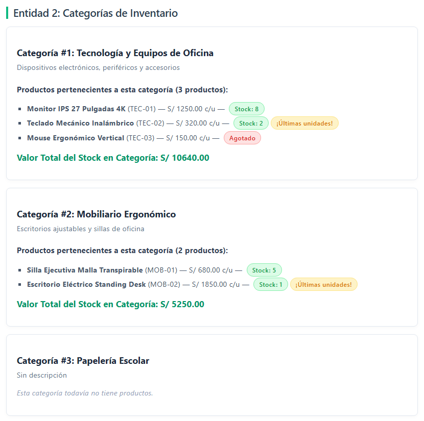

## Ejercicio 11 — Estado, eventos y buscador en la investigación propia

### 1. Botón con estado: "Ver productos" en `TarjetaCategoria`

```jsx
// frontend/src/components/TarjetaCategoria.jsx
import { useState } from 'react';
import Tarjeta from './Tarjeta';
import DetalleCategoria from './DetalleCategoria';

function TarjetaCategoria({ id, nombre, descripcion = 'Sin descripción', productos = [] }) {
  const [abierta, setAbierta] = useState(false);

  const sinProductos = productos.length === 0;

  function alternar() {
    setAbierta(!abierta);
  }

  return (
    <Tarjeta titulo={`Categoría #${id}: ${nombre}`}>
      <p>{descripcion}</p>

      <button
        type="button"
        className="btn-agregar btn-ver-productos"
        onClick={alternar}
        disabled={sinProductos}
      >
        {sinProductos
          ? 'Sin productos'
          : abierta
            ? 'Ocultar productos'
            : `Ver productos (${productos.length})`}
      </button>

      {abierta && <DetalleCategoria productos={productos} />}
    </Tarjeta>
  );
}
```

- **Estado:** `useState(false)` es un booleano local. Cada categoría empieza
  **cerrada**.
- **Evento de clic:** `onClick={alternar}` invierte el valor con
  `setAbierta(!abierta)`. React vuelve a dibujar la tarjeta y
  `abierta && <DetalleCategoria />` muestra u oculta la relación 1:N (lista de
  productos y valor total).
- **El texto del botón depende del estado:** "Ver productos (n)" cuando está
  cerrada y "Ocultar productos" cuando está abierta.
- **Desactivado según un campo del registro:** si `productos.length === 0`, el
  botón dice "Sin productos" y queda `disabled`, porque no hay nada que mostrar.

### 2. Buscador controlado en `ListaCategorias`

```jsx
// frontend/src/components/ListaCategorias.jsx
function ListaCategorias({ categorias, mensajeVacio = 'No hay categorías registradas en el sistema.' }) {
  const [busqueda, setBusqueda] = useState('');

  if (categorias.length === 0) {
    return <p className="alerta-vacio">{mensajeVacio}</p>;
  }

  const texto = busqueda.trim().toLowerCase();
  const filtradas = categorias.filter((cat) =>
    cat.nombre.toLowerCase().includes(texto) ||
    (cat.descripcion ?? '').toLowerCase().includes(texto)
  );

  return (
    <div className="lista-categorias">
      <div className="buscador">
        <input
          type="search"
          className="campo-busqueda"
          placeholder="Buscar categoría por nombre o descripción..."
          value={busqueda}
          onChange={(e) => setBusqueda(e.target.value)}
        />
        <span className="conteo-busqueda">Mostrando {filtradas.length} de {categorias.length}</span>
      </div>

      {filtradas.length === 0 ? (
        <p className="alerta-vacio">Ninguna categoría coincide con "{busqueda}".</p>
      ) : (
        filtradas.map((cat) => (
          <TarjetaCategoria key={cat.id} /* ...props... */ />
        ))
      )}
    </div>
  );
}
```

- **Campo controlado:** `value={busqueda}` y
  `onChange={(e) => setBusqueda(e.target.value)}`.
- **Filtra por nombre *o* descripción**, igual que
  `search_fields = ['nombre', 'descripcion']` del `CategoriaViewSet` de la
  Semana 8, y sin distinguir mayúsculas (`toLowerCase()`).
- **`cat.descripcion ?? ''`**: como la descripción puede ser `null` (categoría
  #3), se reemplaza por una cadena vacía antes de llamar a `toLowerCase()`. Sin
  esto, `null.toLowerCase()` lanzaría un `TypeError` y la página quedaría en
  blanco, como en la prueba del Ejercicio 5.
- Mensaje propio cuando nada coincide y el contador "Mostrando X de Y".

### 3. Interacción 1: botón "Ver productos" (antes y después)

**Antes del clic.** Las tres categorías están cerradas: solo se ven el título,
la descripción y el botón. La #1 dice **"Ver productos (3)"**, la #2 **"Ver
productos (2)"**, y la #3, sin productos, muestra **"Sin productos"** en gris y
desactivado. El buscador está vacío: "Mostrando 3 de 3".

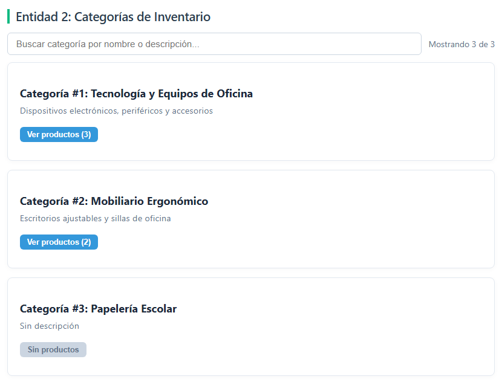

**Después del clic** en "Ver productos (3)" de la Categoría #1. El botón cambia a
**"Ocultar productos"** y aparece su `DetalleCategoria`: los 3 productos con
sus badges y el **Valor Total del Stock: S/ 10640.00**. Las categorías #2 y #3
**no cambian**, porque cada `TarjetaCategoria` tiene su propio estado
`abierta`.

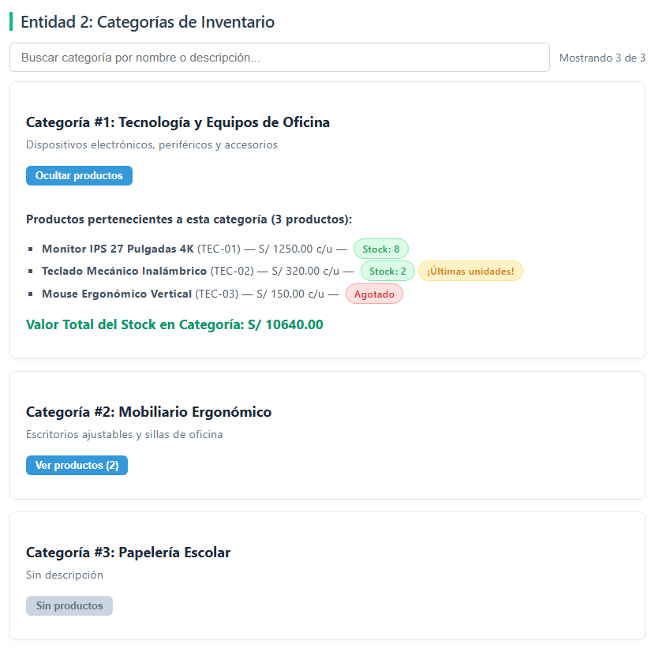

Pruebas adicionales en el navegador:

| Acción | Resultado |
|---|---|
| 2.º clic en "Ocultar productos" (#1) | Vuelve a "Ver productos (3)" y la lista se oculta |
| Clic en "Sin productos" (#3) | No pasa nada: el botón está `disabled` |

### 4. Interacción 2: buscador (antes y después)

**Antes:** campo vacío, "Mostrando 3 de 3". Es la misma captura del estado
inicial de arriba.

**Después — búsqueda `OFICINA` (en mayúsculas):** "Mostrando 2 de 3". Encuentra
la **#1** por su *nombre* ("Equipos de **Oficina**") y la **#2** por su
*descripción* ("sillas de **oficina**"). Esto prueba que busca en los dos campos
y sin distinguir mayúsculas de minúsculas.

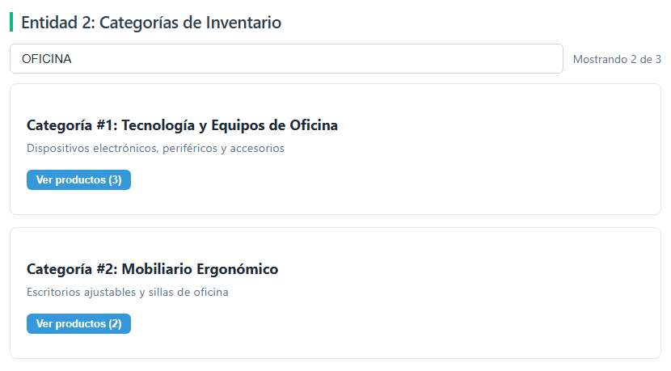

**Después — búsqueda `papel`:** "Mostrando 1 de 3". Solo queda la **#3
Papelería Escolar**. Su descripción es `null` y aun así el filtro no falla.

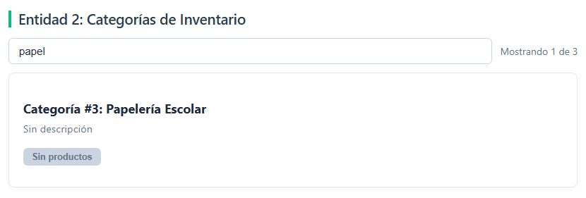

**Después — búsqueda `juguetes`:** "Mostrando 0 de 3" y el mensaje
*"Ninguna categoría coincide con "juguetes"."*

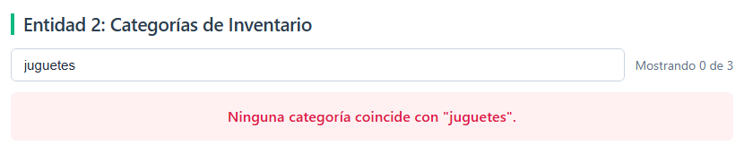

| Texto buscado | Conteo | Categorías mostradas |
|---|---|---|
| *(vacío)* | 3 de 3 | #1, #2, #3 |
| `OFICINA` | 2 de 3 | #1 (por nombre), #2 (por descripción) |
| `papel` | 1 de 3 | #3 Papelería Escolar |
| `juguetes` | 0 de 3 | mensaje de "ninguna coincide" |

### 5. Las dos interacciones juntas: estado y `key`

Prueba combinada: abrir la Categoría #1 y luego escribir en el buscador.

| Paso | Categoría #1 |
|---|---|
| Clic en "Ver productos (3)" | **Ocultar productos** (abierta) |
| Buscar `tecno` (la #1 sigue en la lista) | **Ocultar productos**: sigue abierta |
| Buscar `papel` (la #1 desaparece) | *(no se muestra)* |
| Borrar la búsqueda (la #1 vuelve) | **Ver productos (3)**: volvió **cerrada** |

Mientras la categoría sigue en la lista filtrada, React reconoce que es **el
mismo componente** gracias a `key={cat.id}` y **conserva su estado**, aunque las
demás desaparezcan. Cuando el filtro la saca de la lista, React la
**desmonta** y su estado se descarta. Al volver, es un componente nuevo que
empieza con `useState(false)`. Si se quisiera recordar qué categorías estaban
abiertas aunque se filtren, ese estado tendría que subir a `ListaCategorias`,
por ejemplo como un conjunto de ids abiertos.

La consola del navegador no mostró errores durante las pruebas, y `oxlint`
terminó sin advertencias.

## Ejercicio 12 — Relación anidada y formulario en la investigación propia

### 1. Relación 1:N: un componente dentro de otro

La relación **Categoría → Productos** (1:N; en Django,
`Producto.categoria = ForeignKey(Categoria, related_name='productos')`) se
muestra con componentes anidados en **cuatro niveles**, construidos en los
Ejercicios 10 y 11:

```
ListaCategorias                    categorias.map(cat => <TarjetaCategoria key={cat.id} />)
└── TarjetaCategoria  (estado: abierta)
    └── Tarjeta  (children)
        └── DetalleCategoria       conteo + valor total con reduce()
            └── ItemProductoCategoria   productos.map(prod => <... key={prod.id} />)
```

```jsx
// TarjetaCategoria.jsx: el registro "uno" contiene al componente de la relación
{abierta && <DetalleCategoria productos={productos} />}

// DetalleCategoria.jsx: la relación contiene un componente por cada elemento "muchos"
{productos.map((prod) => (
  <ItemProductoCategoria
    key={prod.id}
    nombreProducto={prod.nombre}
    codigo={prod.codigo}
    precio={prod.precio}
    stock={prod.stock}
  />
))}
<p className="total-categoria">Valor Total del Stock en Categoría: S/ {valorTotal.toFixed(2)}</p>
```

Cada nivel recibe solo lo que necesita por props: `TarjetaCategoria` pasa el
arreglo `productos` a `DetalleCategoria`, y este pasa a cada
`ItemProductoCategoria` los datos de **un** producto. El total se calcula en
`DetalleCategoria` porque es el componente que conoce todos los productos de
la categoría.

Resultado con la Categoría #1 abierta (captura del Ejercicio 11):


### 2. Las categorías pasan al estado (`App.jsx`)

```jsx
import FormularioCategoria from './components/FormularioCategoria'

const [listaCategorias, setListaCategorias] = useState(categorias);

const agregarCategoria = (nueva) => {
  const siguienteId = Math.max(0, ...listaCategorias.map((c) => c.id)) + 1;
  setListaCategorias([...listaCategorias, { id: siguienteId, ...nueva, productos: [] }]);
};

// ...
<Tarjeta titulo="Registrar nueva categoría">
  <FormularioCategoria onAgregar={agregarCategoria} />
</Tarjeta>

<ListaCategorias categorias={listaCategorias} />
```

- Igual que en el Ejercicio 8, `datos.js` es solo el **valor inicial** del estado.
- Se agrega con un **arreglo nuevo** (`[...listaCategorias, nueva]`), **sin
  `push`**, para que React detecte el cambio de referencia y vuelva a dibujar.
- La categoría nueva empieza con `productos: []`. Así la relación 1:N tiene
  siempre la misma forma, y su botón aparece como **"Sin productos"**
  (desactivado) por la regla del Ejercicio 11.

### 3. El formulario (`FormularioCategoria.jsx`)

```jsx
import { useState } from 'react';

const formularioVacio = { nombre: '', descripcion: '' };

function validar(datos) {
  const errores = {};
  const nombre = datos.nombre.trim();

  if (nombre.length < 3) {
    errores.nombre = 'El nombre de la categoría debe tener al menos 3 caracteres.';
  } else if (nombre.length > 100) {
    errores.nombre = 'El nombre no puede tener más de 100 caracteres.';
  }

  return errores;
}

function FormularioCategoria({ onAgregar }) {
  const [datos, setDatos] = useState(formularioVacio);
  const [errores, setErrores] = useState({});
  const [mensajeExito, setMensajeExito] = useState('');

  function manejarCambio(e) {
    const { name, value } = e.target;
    setDatos({ ...datos, [name]: value });
    setMensajeExito('');
  }

  function manejarEnvio(e) {
    e.preventDefault();

    const nuevosErrores = validar(datos);
    setErrores(nuevosErrores);

    if (Object.keys(nuevosErrores).length > 0) {
      setMensajeExito('');
      return;
    }

    const descripcion = datos.descripcion.trim();

    onAgregar({
      nombre: datos.nombre.trim(),
      descripcion: descripcion === '' ? null : descripcion,
    });

    setMensajeExito(`Categoría "${datos.nombre.trim()}" agregada a la lista.`);
    setDatos(formularioVacio);
  }

  return (
    <form className="form-categoria" onSubmit={manejarEnvio} noValidate>
      <label className="form-campo form-campo-ancho">
        Nombre
        <input name="nombre" value={datos.nombre} onChange={manejarCambio} placeholder="Ej.: Útiles de Arte" />
        {errores.nombre && <span className="form-error">{errores.nombre}</span>}
      </label>

      <label className="form-campo form-campo-ancho">
        Descripción (opcional)
        <textarea name="descripcion" rows="2" value={datos.descripcion} onChange={manejarCambio}
                  placeholder="Ej.: Témperas, pinceles y lienzos" />
      </label>

      <button type="submit" className="btn-guardar">Agregar categoría</button>
      {mensajeExito && <p className="form-exito">{mensajeExito}</p>}
    </form>
  );
}
```

- **Campos controlados:** un `<input>` y un `<textarea>`, ambos con `value` del
  estado `datos` y el mismo `onChange={manejarCambio}`, que usa `e.target.name`
  y `e.target.value`.
- **`onSubmit` + `e.preventDefault()`** evitan que el navegador recargue la
  página al enviar.
- **Los campos se limpian** con `setDatos(formularioVacio)` solo después de un
  envío válido.
- **La descripción vacía se guarda como `null`**, igual que la guardaría
  Django (`TextField(blank=True, null=True)`). Al mostrarse, el valor por
  defecto de `TarjetaCategoria` la convierte en "Sin descripción".

### 4. Validación tomada de la API de la Semana 8

| Regla | Formulario React | API Django (Semana 8) |
|---|---|---|
| Nombre de al menos 3 caracteres | `datos.nombre.trim().length < 3` → *"El nombre de la categoría debe tener al menos 3 caracteres."* | `CategoriaSerializer.validate_nombre`: `if len(value.strip()) < 3: raise ValidationError("El nombre de la categoría debe tener al menos 3 caracteres.")` |
| Nombre de máximo 100 caracteres | `> 100` → mensaje de error | `nombre = models.CharField(max_length=100)` |
| Descripción opcional | sin validación; `''` → `null` | `descripcion = models.TextField(blank=True, null=True)` |

`trim()` en JavaScript cumple el mismo papel que `.strip()` en Python. Por eso
un nombre como `"  TI "` se considera de **2** caracteres en ambos lados.

### 5. Envío inválido

**Antes de enviar:** el formulario está vacío y la lista muestra "Mostrando 3 de
3".

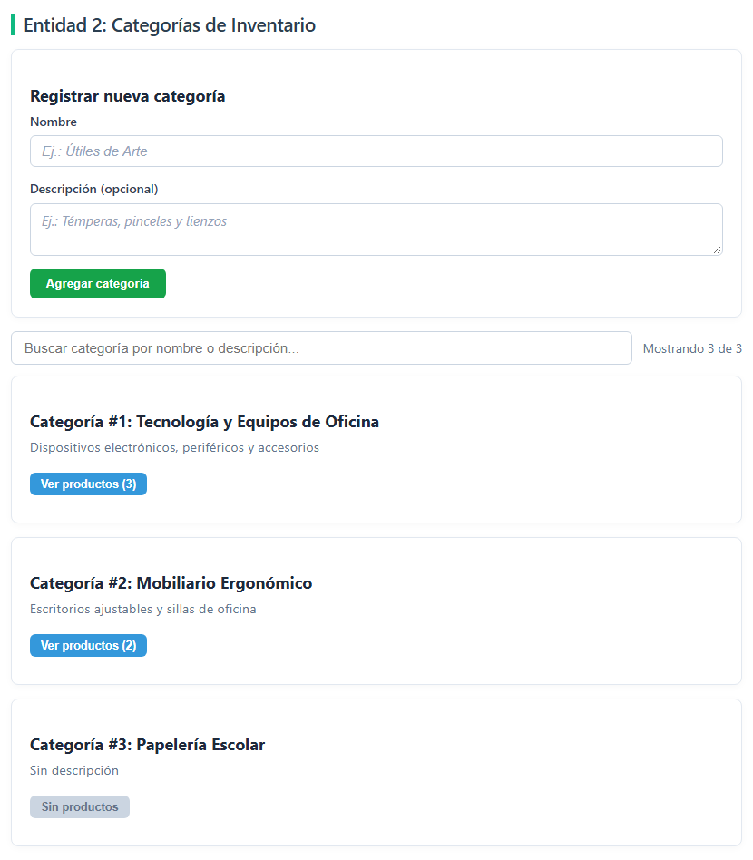

**Datos enviados:** Nombre `"  TI "` (2 letras rodeadas de espacios) y
Descripción `"Tecnologia de la informacion"`.

**Resultado:**
- Aparece el mensaje en rojo debajo del nombre: *"El nombre de la categoría debe
  tener al menos 3 caracteres."*
- **No** se agrega ninguna categoría: la lista sigue en "Mostrando 3 de 3".
- Los campos **conservan** lo escrito para que el usuario corrija, y la URL no
  cambia (no hubo recarga).

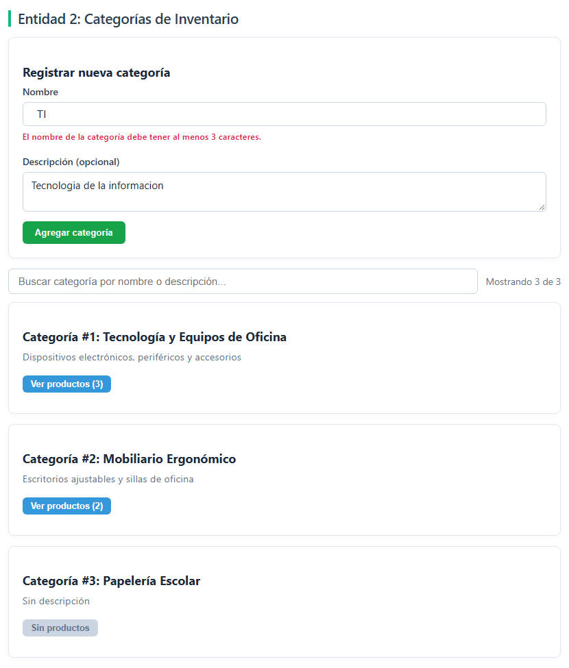

### 6. Envío válido

**Datos enviados:** Nombre `Útiles de Arte`, Descripción `Témperas, pinceles y
lienzos`.

**Resultado:**
- Mensaje verde: *Categoría "Útiles de Arte" agregada a la lista.*
- La lista pasa a **"Mostrando 4 de 4"** y aparece la **Categoría #4: Útiles de
  Arte** con su descripción. El id 4 se calculó como el mayor existente + 1.
- El botón de la nueva categoría muestra **"Sin productos"** (desactivado),
  porque se creó con `productos: []`.
- Los dos campos quedan **vacíos** (solo se ven los *placeholders* "Ej.: …").

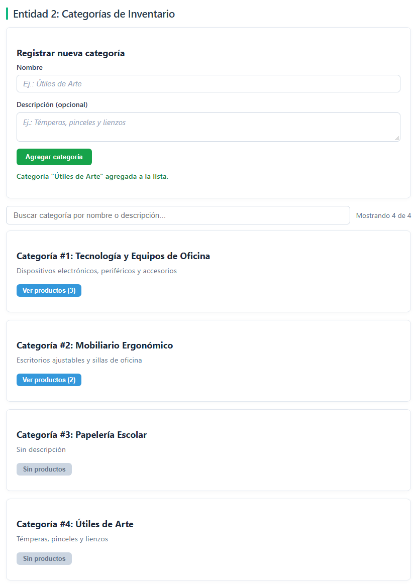

| Envío | Nombre | Descripción | ¿Se agrega? | Mensaje | Campos |
|---|---|---|---|---|---|
| Inválido | `"  TI "` | Tecnologia de la informacion | No (3 de 3) | error de longitud mínima | se conservan |
| Válido | `Útiles de Arte` | Témperas, pinceles y lienzos | Sí (4 de 4) | éxito | se limpian |

Las dos pruebas se hicieron escribiendo y haciendo clic en el navegador. La
consola no mostró errores, y `oxlint` terminó sin advertencias.

## Ejercicio 13 — Verificar la interfaz de la investigación propia

### 1. Consola del navegador: sin advertencias

Se cargó la aplicación con `npm run dev` y se recorrieron **todas** las
interacciones mientras se registraba cada mensaje que llegaba a la consola
(`console.log/info/warn/error`, excepciones no capturadas y mensajes del
navegador), mediante el protocolo de depuración de Chrome:

1. Clic en cada botón "+ Agregar" de las tarjetas de producto y en cada "Ver
   productos" de las categorías.
2. Clic en "Ocultar productos".
3. Escritura en los **3 buscadores** (Listado, Entidad 1 y Categorías) con
   `CUADERNO`, `ar`, `oficina`, `zzz` y vacío.
4. Formulario de producto: un envío **inválido** y uno **válido**.
5. Formulario de categoría: un envío **inválido** y uno **válido**.

**Resultado: 0 errores y 0 advertencias.** Los únicos 3 mensajes son
informativos y aparecen en cualquier proyecto Vite + React en modo desarrollo:

| Nivel | Mensaje | Origen |
|---|---|---|
| Verbose | `[vite] connecting...` | cliente de recarga en caliente de Vite |
| Verbose | `[vite] connected.` | cliente de recarga en caliente de Vite |
| Info | `Download the React DevTools for a better development experience` | sugerencia de React en modo desarrollo |

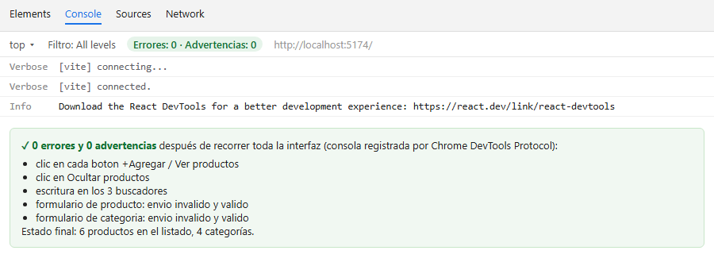

Registro completo en
[`capturas/ej13-consola-registro.json`](capturas/ej13-consola-registro.json).
La prueba también se hizo a mano en el panel del navegador, haciendo clic y
escribiendo, y el filtro de errores quedó vacío.

**Revisión en el código de las dos advertencias típicas de React:**

| Advertencia de React | Cómo se evitó | Comprobación |
|---|---|---|
| *Each child in a list should have a unique "key" prop* | Cada `map()` que devuelve JSX pone `key` con el `id` del registro | Los 5 `map()` de JSX tienen `key`: `pedido.id`, `det.id`, `prod.id` (×2) y `cat.id` |
| *You provided a `value` prop to a form field without an `onChange` handler* | Todo campo con `value` tiene su `onChange` que actualiza el estado | 8 `value={...}` y 8 `onChange=` (4 en `FormularioProducto`, 2 en `FormularioCategoria` y 1 en cada buscador) |

### 2. `npm run lint` y `npm run build`

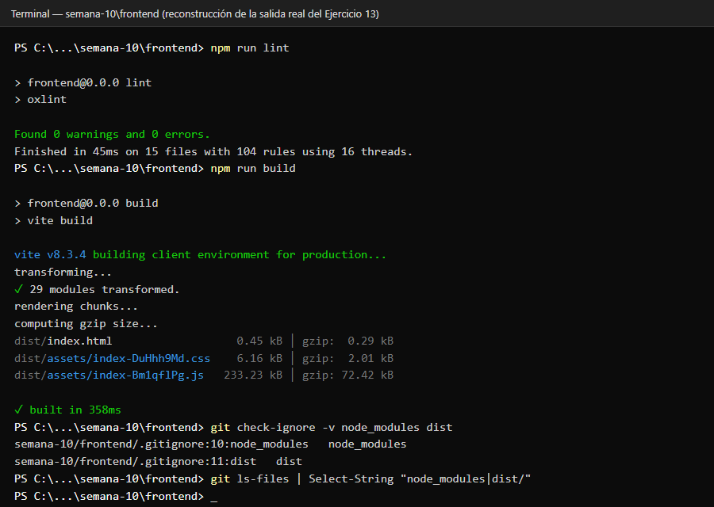

```
PS semana-10\frontend> npm run lint

> frontend@0.0.0 lint
> oxlint

Found 0 warnings and 0 errors.
Finished in 45ms on 15 files with 104 rules using 16 threads.
```

```
PS semana-10\frontend> npm run build

> frontend@0.0.0 build
> vite build

vite v8.3.4 building client environment for production...
transforming...
✓ 29 modules transformed.
rendering chunks...
computing gzip size...
dist/index.html                   0.45 kB │ gzip:  0.29 kB
dist/assets/index-DuHhh9Md.css    6.16 kB │ gzip:  2.01 kB
dist/assets/index-Bm1qflPg.js   233.23 kB │ gzip: 72.42 kB

✓ built in 358ms
```

Salida en texto:
[`capturas/ej13-npm-run-lint-build.txt`](capturas/ej13-npm-run-lint-build.txt).

| | Ejercicio 8 | Ejercicio 13 | Diferencia |
|---|---|---|---|
| Archivos revisados por `oxlint` | 10 | **15** | +5 componentes de la investigación propia |
| Resultado del lint | 0 warnings, 0 errors | **0 warnings, 0 errors** | — |
| Módulos del build | 24 | **29** | +5 módulos |
| JS generado | 230.13 kB (gzip 71.92 kB) | **233.23 kB** (gzip 72.42 kB) | +3 kB |
| CSS generado | 5.50 kB | **6.16 kB** | estilos de buscador, formulario y botones |

Los dos comandos terminan con **código de salida 0**.

> **Sobre las imágenes:** la consola se registró con el protocolo de depuración
> de Chrome y la terminal se ejecutó desde un proceso automatizado. Por eso las
> dos imágenes de arriba son una **reconstrucción visual de la salida real**
> obtenida (mismos textos, tamaños y hashes de archivo), no capturas de pantalla
> de una ventana. Si se necesita una captura directa de pantalla, basta con
> abrir DevTools (F12 → Console) con la app en marcha y ejecutar
> `npm run lint` y `npm run build` en una terminal: la salida debe ser idéntica.

### 3. `node_modules` y `dist` no están en el repositorio

```
$ git ls-files | grep -E '(^|/)(node_modules|dist)/'
(sin resultados: ningún archivo de node_modules ni dist está en el repositorio)

$ git check-ignore -v frontend/node_modules frontend/dist
semana-10/frontend/.gitignore:10:node_modules   frontend/node_modules
semana-10/frontend/.gitignore:11:dist   frontend/dist

$ git status --short --ignored frontend
!! frontend/.venv/
!! frontend/dist/
!! frontend/node_modules/
```

- **`git ls-files`** no devuelve nada: ningún archivo de esas carpetas está
  versionado.
- **`git check-ignore -v`** confirma que las ignora la regla de las líneas 10 y
  11 de `frontend/.gitignore`, que Vite crea al generar el proyecto.
- **`git status --ignored`** las marca con `!!` (ignoradas).

**Por qué no deben subirse:**
- **`node_modules/`** contiene las dependencias descargadas (cientos de MB y
  miles de archivos). Se reconstruye exactamente con `npm install` a partir de
  `package.json` y `package-lock.json`, que **sí** se versionan.
- **`dist/`** es el resultado de `npm run build`. Se regenera en cada build y su
  nombre de archivo cambia con cada versión (`index-Bm1qflPg.js`), así que
  versionarlo solo produciría conflictos y diferencias innecesarias.

**Problema encontrado y corregido.** La carpeta `semana-10` no tenía un
`.gitignore` en su raíz, por lo que un `git add .` habría subido archivos que
no deben versionarse, como `src/**/__pycache__/*.pyc`, `src/db.sqlite3` y
`.claude/`. Se agregó `semana-10/.gitignore` con las mismas reglas que el de la
Semana 9, más `node_modules/` y `dist/` como respaldo:

```
venv/
*.pyc
__pycache__/
db.sqlite3
.vscode/
.claude/
node_modules/
dist/
```

Después del cambio, `git add --dry-run .` no incluye **ningún** archivo de
`node_modules`, `dist`, `__pycache__`, `db.sqlite3` ni `.claude` (0
coincidencias). Salida completa en
[`capturas/ej13-git-ignorados.txt`](capturas/ej13-git-ignorados.txt).

## Ejercicio 14 — Publicar en GitHub

### 1. README actualizado

Al inicio de este README se agregaron:

- la **URL del repositorio**;
- **cómo ejecutar el frontend** (`npm install` y `npm run dev`, además de
  `lint`, `build` y `preview`);
- una **tabla de componentes** que dice qué hace cada uno, sus props y su
  estado;
- el **árbol de componentes** de `App.jsx`;
- la explicación de **qué resuelven las props y el estado** y qué falta para
  guardar en Django;
- un **índice de ejercicios** con sus capturas.

### 2. Qué se sube y qué no

Se versiona solo lo necesario para reconstruir y ejecutar el proyecto:

| Se sube | No se sube (y por qué) |
|---|---|
| `frontend/src/` (componentes, `App.jsx`, `datos.js`, CSS) | `frontend/node_modules/`: se reconstruye con `npm install` |
| `frontend/package.json` y `package-lock.json` | `frontend/dist/`: se regenera con `npm run build` |
| `frontend/index.html`, `vite.config.js`, `.oxlintrc.json`, `public/` | `__pycache__/`, `*.pyc`, `db.sqlite3`: archivos generados |
| `README.md`, `.gitignore`, `capturas/` | `.claude/`: configuración local del editor |

Antes del commit se comprobó con `git add --dry-run` que **ninguno** de los 67
archivos a subir pertenece a `node_modules/`, `dist/` ni `.venv/`
(0 coincidencias). Las reglas están en `frontend/.gitignore` (creado por Vite)
y en `semana-10/.gitignore` (Ejercicio 13).

### 3. Commit y push

Se agregaron **solo** los archivos de esta semana, sin tocar los cambios
pendientes de otras semanas:

```powershell
git add semana-10/.gitignore semana-10/README.md semana-10/capturas semana-10/frontend
git commit -m "Semana 10: componentes, props, estado y formularios en React"
git push origin main
```

### 4. Dirección del repositorio

- **Repositorio:** <https://github.com/Davish-pxl/APLICACIONES-EMPRESARIALES-CICLO-IV->
- **Semana 10:** <https://github.com/Davish-pxl/APLICACIONES-EMPRESARIALES-CICLO-IV-/tree/main/semana-10>
- **Frontend:** <https://github.com/Davish-pxl/APLICACIONES-EMPRESARIALES-CICLO-IV-/tree/main/semana-10/frontend>
- **Componentes:** <https://github.com/Davish-pxl/APLICACIONES-EMPRESARIALES-CICLO-IV-/tree/main/semana-10/frontend/src/components>

Para clonarlo y ejecutarlo desde cero:

```powershell
git clone https://github.com/Davish-pxl/APLICACIONES-EMPRESARIALES-CICLO-IV-.git
cd APLICACIONES-EMPRESARIALES-CICLO-IV-/semana-10/frontend
npm install
npm run dev
```
